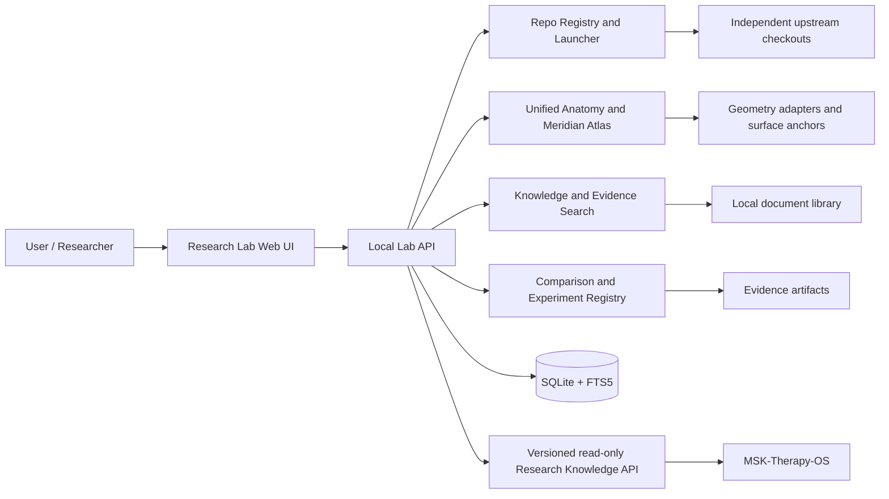

# MSK Research Lab OS
## Engineering Specification and Coding-Agent Handoff
### Flagship Module: Unified Acupuncture & Meridian Atlas

**Document ID:** MRL-SPEC-001  
**Version:** 1.0 (implementation baseline)  
**Date:** 2026-10-22  
**Language:** English  
**Status:** Proposed architecture; implementation has **not** been performed by this document  
**Target:** Local-first Windows 10/11 + Ubuntu under WSL2; Intel Core i7-5600U, 8 GB RAM, Intel HD Graphics 5500, ~238 GB SSD  
**Primary consumer:** MSK Research Lab OS, independent of `MSK-Therapy-OS`  
**Secondary consumer:** MSK-Therapy-OS through a versioned, read-only Knowledge API

---

## 1. Executive Decision

Build **MSK Research Lab OS** as an independent, local-first research and experimentation platform that can discover, register, safely inspect, clone, run, benchmark, compare, and learn from open-source repositories and user-owned research materials.

Its first flagship feature is a **Unified Acupuncture & Meridian Atlas**. The end-user should encounter **one coherent research application**, not a permanent collection of nine disconnected localhost windows. However, source repositories remain separately versioned and independently runnable as upstream research specimens.

**Guiding rule: unify experiences, data contracts, and verified capabilities; do not blindly merge upstream application code.**

### 1.1 Primary outcomes

1. Register upstream Git repositories with exact commit SHA, origin, license findings, dependency manifest, run recipe, and audit history.
2. Launch supported upstream applications locally, one at a time by default, and record their outputs and performance.
3. Present a unified interactive 3D human anatomy viewer with per-system/per-structure visibility and deep-layer inspection.
4. Register acupoints and meridian-path *renderings* to an explicit skin surface mesh with traceable geometry, coordinate conventions, and uncertainty.
5. Cross-reference point identities, claims, and data differences across heterogeneous sources without erasing disagreements.
6. Provide an editor for private research atlases, including nonstandard modalities (e.g., Diện Chẩn / facial reflexology), and support image-based 2D reference charts.
7. Ingest user-supplied PDF, EPUB, and DOCX into a searchable, citable local knowledge library.
8. Serve relevant, source-linked research content to MSK-Therapy-OS through a stable local API without coupling databases or processes.
9. Retain an inspectable evidence trail for integration decisions, screenshots, software versions, geometry tests, performance measures, and licensing.

### 1.2 Explicit non-goals

- Not a replacement operating system, Linux distribution, Windows shell, or clinical EHR.
- Not an automatic diagnostic engine, treatment planner, needling navigation system, or source of safe acupuncture depths.
- Not a mechanism for converting traditional meridians into asserted physical nerves, vessels, fascia, or measurable anatomical conduits.
- Not a project to run all upstream frameworks and 3D renderers in one web page.
- Not permission to redistribute copyrighted books, third-party meshes, proprietary diagrams, or unclear-license ontology data.
- Not a plan to make arbitrary open-source installation scripts execute automatically with unrestricted user permissions.
- Not deployment with real patient data until separate privacy, regulatory, security, and professional reviews have passed.

## 2. Deployment and Resource Constraints

| Constraint | Required design response |
|---|---|
| Windows host + Ubuntu WSL2 | Python backend in WSL, browser on Windows, localhost networking, POSIX process management and Windows-path interoperability. |
| 8 GB system RAM | Default to one 3D viewer and at most one upstream demo at once; queue heavy work; cap worker processes and capture memory usage. |
| Intel HD Graphics 5500 | Region-based lazy loading, adjustable LOD, capped pixel ratio, minimal transparent overlays, no real-time full-body FEM. |
| 238 GB SSD | Upstream size estimates, optional asset/download gates, cache accounting, clearable builds, content-addressed original-document store. |
| Local-first | SQLite + FTS5; API on `127.0.0.1`; no required cloud services or mandatory model APIs. |
| Educational/research use | Synthetic examples by default; visible provenance and explicit non-clinical precision labels. |

**Proposed baseline:** Python 3.11+ backend, SQLite/FTS5, a lightweight local web UI, and a **single** Three.js-based anatomy runtime. Use targeted libraries such as `three-mesh-bvh` as pinned npm dependencies after verifying compatibility with the chosen Three.js revision. Add FastAPI only if its routing, validation, and documentation justify the extra runtime; Python stdlib HTTP is acceptable for a minimal Phase 0. Choose **one** backend approach, document it, and test it.

Do not mix Windows virtual environments with WSL virtual environments. Never assume a project cloned to `/mnt/d` has the same filesystem performance or executable behavior as one cloned in the WSL filesystem.

---

## 3. Upstream Research Inventory

The repo registry must distinguish **research source**, **candidate reusable code**, **data**, **assets**, and **third-party licenses**. A GitHub repository's license never automatically applies to every mesh, document, image, dataset, or external standard bundled inside it.

| Priority | Repository / package | Planned research value | Integration stance | Preliminary license notes |
|---|---|---|---|---|
| P0 | [CognitionLabSNUC/open-anatomy-atlas](https://github.com/CognitionLabSNUC/open-anatomy-atlas) | Baseline renderer; layer tree, isolation, X-ray, clipping/sections; BodyParts3D and optional Z-Anatomy support | **Primary candidate viewer**, benchmark first | Code MIT; anatomy assets independently licensed |
| P0 | [JICio/tcm-3d](https://github.com/JICio/tcm-3d) | Acupoint catalogue, skin-triangle anchoring, `scripts/bake-meridian-surface.mjs`, baked bilateral/midline routes | **Algorithm/data reference and adapter** | Code MIT; BodyParts3D attribution required; point positions explicitly not clinically reviewed |
| P0 | [eb-barry/acupuncture-3d-authoring](https://github.com/eb-barry/acupuncture-3d-authoring) | Surface-aware point/curve editor, control points, undo/redo, local GLB editing, JSON round-trip | **Behavior reference; conditional code reuse** | No root `LICENSE` found in preliminary audit; seek explicit source-code license before copying code. Bundled male/female models have separate CC BY attribution requirements |
| P0 | [galaxy-hzy/meridian-atlas](https://github.com/galaxy-hzy/meridian-atlas) | Traditional Chinese text, chants, explanations, meridian/point learning records, sources | **Isolated research source; selective lawful data import** | Code AGPL-3.0; review network-use/copyleft obligations before incorporating source code or distributing an integrated service |
| P0 | [SciCrunch/TARA-Ontology-Repository](https://github.com/SciCrunch/TARA-Ontology-Repository) | TARA acupoint ontology, curated CSV, identifiers, relationships, semantic mapping | **Ontology adapter with provenance** | No root `LICENSE` found in preliminary audit; confirm rights for each curated dataset and ontology distribution before redistribution |
| P1 | [WaterCMY/anatomy-3d](https://github.com/WaterCMY/anatomy-3d) | Muscle superficial/deep filter, region UI, curve projection heuristics, lightweight GLB example | **Independent comparison reference** | Code MIT; bundled model is described as derivative CC BY-SA and requires separate audit |
| P1 | [spacejohnlf/tcm-acupoints](https://github.com/spacejohnlf/tcm-acupoints) | Direction-constrained snap-to-mesh, surface normals, GLB workflow | **Algorithm comparison** | Code MIT; model attribution/share-alike obligations separate |
| P1 | [GiorgioHuang/chino-meds](https://github.com/GiorgioHuang/chino-meds) | Searchable point descriptions and knowledge associations | **Evidence/knowledge candidate, validate claims** | Code MIT; verify source provenance and evidence grading instead of trusting labels |
| P2 | [slorksmo/Human-Atlas](https://github.com/slorksmo/Human-Atlas) | Alternative reference anatomy and male/female rendering experiments | **Later-stage comparison, not presumed clinically validated** | Code MIT; third-party anatomical asset licensing separate |
| Dependency | [gkjohnson/three-mesh-bvh](https://github.com/gkjohnson/three-mesh-bvh) | Accelerated raycasting, nearest-point/triangle queries | **Pinned package; no full repo clone required for production** | MIT; version and Three.js compatibility required |
| Optional research aid | [morluto/rea](https://github.com/morluto/rea) | Reverse-engineering investigation of opaque apps, binaries, web UIs | **Optional offline tool; not an architectural dependency** | Not required for publicly available source-code projects |

**Counts:** Nine candidate repositories across P0/P1/P2, plus `three-mesh-bvh` as a dependency and REA as an optional investigation tool. All nine may be catalogued and cloned on demand; execution or feature promotion must be staged.

**Audit note (2026-10-22):** GitHub repository existence and several root license files were checked. This table is a **preliminary planning audit**, not a complete legal determination. A coding agent must inspect the exact pinned revisions, upstream submodules, model provenance, individual dataset licenses, contributor notices, and download terms before distribution.

### 3.1 Clone policy

- Register first; capture origin URL, default branch, tip SHA, manifest types, estimated size and license signals.
- Prefer shallow, filtered clones where upstream permits, e.g. `git clone --depth 1 --filter=blob:none`; **pin SHA** immediately after inspection. Reproducibility is more important than tracking `main` implicitly.
- Skip LFS/heavy model downloads until the user deliberately activates that repo or experiment.
- Track Git upstream as a normal standalone checkout under `workspace/upstream/`. Do **not** place unrelated repos inside MSK Research Lab OS's own Git history as copied source trees.
- Do not automatically run arbitrary `postinstall`, shell install scripts, root-level hooks, privileged commands, or unapproved external downloads.
- Maintain an allowlisted execution recipe per tested repo. Use separate `.venv`, npm cache, worktree, and designated local port where applicable.
- Refuse an ambiguous license or unsuitable hardware condition with an actionable explanation, not a fabricated "PASS".

---

## 4. System Architecture and Ownership Boundaries



### 4.1 Process boundary

1. **Research Lab server:** Owns lab database, repo metadata, normalized research index, process control, and evidence provenance.
2. **Unified Atlas viewer:** Owns a single primary Three.js canvas and feature layers; loaded anatomy assets are versioned and attributable.
3. **Upstream apps:** Spawn independently only for audit, demos, and comparison, each with a separately assigned localhost port. Do not iframe untrusted demos into the privileged main application by default.
4. **Document indexing workers:** On-demand, resource-limited jobs, not constantly running background ML services.
5. **Therapy OS:** Entirely separate repository, database, release lifecycle, and security boundary. Reads a restricted, versioned interface; never mounts Lab DB as a shared writable database.

### 4.2 Suggested repository layout

```text
msk-research-lab-os/
├── README.md
├── AGENTS.md
├── LICENSE                 # Lab's own license only
├── pyproject.toml
├── .gitignore
├── config/
│   ├── defaults.toml
│   ├── repo-catalog.yaml
│   └── source-policy.yaml
├── lab/
│   ├── app.py              # API + lifespan
│   ├── cli.py              # lab doctor/repo/launch/test/export
│   ├── config.py
│   ├── db/
│   │   ├── migrations/
│   │   └── models.py
│   ├── repos/
│   │   ├── registry.py
│   │   ├── git_client.py
│   │   ├── manifest_detector.py
│   │   ├── license_audit.py
│   │   └── launcher.py
│   ├── atlas/
│   │   ├── identities.py
│   │   ├── geometry_registry.py
│   │   ├── source_adapters/
│   │   ├── surface_registration.py
│   │   ├── path_baker.py
│   │   ├── editor.py
│   │   └── comparisons.py
│   ├── knowledge/
│   │   ├── ingestion.py
│   │   ├── extract_pdf.py
│   │   ├── extract_epub.py
│   │   ├── extract_docx.py
│   │   ├── citations.py
│   │   ├── index_fts.py
│   │   └── semantic_optional.py
│   ├── evidence/
│   │   ├── registry.py
│   │   ├── benchmark.py
│   │   └── validation.py
│   ├── api/
│   │   ├── repos.py
│   │   ├── atlas.py
│   │   ├── knowledge.py
│   │   └── export.py
│   └── security/
│       ├── process_policy.py
│       ├── permissions.py
│       └── sanitization.py
├── web/
│   ├── dashboard/
│   ├── atlas-viewer/        # Exactly one production renderer
│   ├── atlas-editor/
│   ├── comparisons/
│   └── knowledge-library/
├── schemas/
│   ├── repo-manifest.schema.json
│   ├── atlas-point.schema.json
│   ├── surface-anchor.schema.json
│   ├── source-claim.schema.json
│   └── api-v1.openapi.yaml
├── scripts/
│   ├── dev.sh
│   ├── verify.sh
│   └── benchmark.sh
├── tests/
│   ├── unit/
│   ├── integration/
│   ├── browser/
│   └── fixtures/           # Synthetic and licensed only
├── docs/
│   ├── architecture.md
│   ├── research-method.md
│   ├── license-matrix.md
│   ├── coordinate-conventions.md
│   ├── operating-guide-wsl.md
│   └── evidence-index.md
└── workspace/              # Ignored by Lab's Git repository
    ├── upstream/           # Separately pinned checkouts
    ├── data/
    │   ├── originals/      # User documents, local only
    │   ├── extracted/
    │   └── normalized/
    ├── anatomy-assets/
    ├── experiments/
    ├── evidence/
    ├── cache/
    ├── logs/
    └── lab.sqlite3
```

**Workspace exception:** Confidential/user-supplied source documents, generated embeddings, personal research notes, model binaries, and screenshots containing sensitive data must never be committed. All paths under `workspace/` must be `.gitignore`-protected. Default to local storage; do not silently sync user books or models to external services.

---

## 5. Canonical Data Model

Use a **source-aware graph implemented initially in relational SQLite**, not a premature graph database. Ontology mappings and source-claim relations can be modeled through edge tables and queried deterministically.

### 5.1 Required entities

| Entity | Required information |
|---|---|
| `Repository` | Stable ID, URL, pinned commit, branch/tag, manifest, run recipe, license findings, status |
| `SourceArtifact` | Repo/file/document identifier, SHA-256, source revision, attribution, ownership/license, import timestamp |
| `CanonicalPoint` | Internal stable UUID, canonical coding system where applicable, normalized label, tradition/namespace, laterality semantics |
| `PointAlias` | Source-specific name, code, spelling, transliteration, source and mapping confidence |
| `PointPlacement` | Source-specific location, model reference, pose, coordinate system, units, side, landmarks, quality status |
| `SkinAnchor` | Model/mesh hash, mesh ID, face index, barycentric weights, local-space surface position/normal, validation metrics |
| `MeridianConcept` | Tradition-specific named meridian/path concept, source, synonyms, interpretation bounds |
| `RenderedPath` | Display segments, ordered points, geometric surface anchors, authoring revision and quality metrics |
| `SourceClaim` | Original claim in source terminology, source locator, knowledge type, evaluation status, contested/contradictory links |
| `EvidenceReference` | Source title, URI/DOI where present, author, year, edition, page/section, evidence appraisal |
| `ResearchAtlas` | Owner, title, tradition, visibility, revision, base chart/model, usage policy |
| `ResearchAnnotation` | Point/region, image or mesh anchor, note, observation type, synthetic subject/session link where applicable |
| `Document` and `DocumentChunk` | Original checksum, format, ownership/access, page/chapter/paragraph spans, text, index references |
| `Experiment` | Purpose, repo revisions, hypothesis, config, observations, evidence files, limitations, verdict |

### 5.2 Source-claims must not be flattened into facts

Keep distinct fields for:

- `traditional_description`: What a particular school or author says.
- `geometry_observation`: What the actual renderer or algorithm measured.
- `clinical_evidence`: What a cited study or review demonstrates, with assessment of quality and applicability.
- `research_hypothesis`: What a researcher proposes but has not verified.
- `individual_observation`: What was observed in a single exercise/session, not a universal point location or effect.

**Never** silently upgrade `traditional_description` to clinical evidence. A high-quality geometric registration result cannot establish treatment effectiveness.

### 5.3 Point identity versus position

A point concept (`GB21`, for instance) is **not equal** to a universal XYZ coordinate. Multiple sources may agree on its conceptual name but disagree on exact location, landmark interpretation, body pose, side, or mesh registration. Preserve those differences in `PointPlacement` with attribution.

Recommended identity hierarchy:

```text
KnowledgeNamespace -> CodingSystem -> CanonicalPoint -> SourcePlacement -> MeshAnchor
                                               |               |
                                               v               v
                                           SourceClaims    QualityMetrics
```

Do not assume that a TARA concept ID, WHO/GB/T label, a source's local ID, an FMA anatomical ID, and a mesh node name represent the same thing. Use explicit mapping tables with relationship kinds: `exact_match`, `close_match`, `related_to`, `contradicts`, and `unresolved`. Keep the original identifiers.

### 5.4 Example normalized point record

```json
{
  "point_id": "urn:msk-lab:point:traditional-acupuncture:GB21",
  "display_name": "Jianjing",
  "traditional_system": "TCM",
  "point_code": "GB21",
  "laterality": "bilateral",
  "review_status": "research_only_unverified",
  "source_placements": [
    {
      "source_id": "jicio-tcm-3d@<pinned-sha>",
      "source_code": "GB21",
      "side": "left",
      "model_id": "bodyparts3d-4.0-reference-male",
      "model_asset_sha256": "<actual-sha256-required>",
      "coordinate_frame": "mesh_local",
      "surface_anchor_id": "<generated-anchor-id>",
      "registration_status": "geometry_pass_clinical_unreviewed"
    }
  ]
}
```

Angles, distances, units, orientation, left-right handedness, model scale, and default reference pose **must** be specified in `docs/coordinate-conventions.md`. Example values above are illustrative placeholders in a design specification, **not** real patient or point measurements.

---

## 6. Unified 3D Anatomy Viewer

### 6.1 Required interactions

- Human reference body with explicit model identity, version, source, and sex representation where available.
- Region hierarchy: head/face, cervical region, shoulder, upper limb, thorax, lumbar/pelvis, lower limb.
- Layer tree: skin, superficial muscles, intermediate/deep muscles, bones, joints/cartilage, fascia, nerves, blood vessels and other systems **only when source model provides them**.
- Toggle, isolate, focus, X-ray, opacity, clipping/section planes, hide/show labels, and reset view.
- Click structures to show source name, anatomical label, mesh ID, available FMA/other concepts, attribution, and links to research notes.
- Camera and selection state must be synchronized. Choosing *neck* cannot leave an unexplained selected *thigh* muscle in the inspector.
- Per-region overlays; default to **no global meridian spaghetti**. Hide unrelated lines/points when studying a region.
- Show occlusion-correct points and paths by default. An optional explicitly labeled X-ray/see-through mode may override occlusion.
- Display gaps and registration warnings where anatomy/point definitions are missing. No silently invented muscles, joints, or hidden layers.
- Responsive desktop layout: usable at 1366x768 without clipped tab titles, vertical letters or unexpected horizontal toolbars.

### 6.2 Surface registration contract

The module must work on a **declared external skin mesh** in a known coordinate space, rather than treating any visible muscle mesh, convex hull, or arbitrary polygon as equivalent to skin.

Required pipeline:

1. Load geometry metadata, reference pose, units, transform matrix, model/mesh checksum, surface quality, and anatomical landmark references.
2. Convert source point/line coordinates to the model's documented frame; validate orientation and left/right handedness.
3. Reject impossible/ambiguous input candidates before any snapping. Use landmarks and region priors to constrain candidates.
4. Use BVH-accelerated raycast/nearest-triangle queries where appropriate, recording candidate distances and normal directions.
5. Inspect side, anatomical region, local surface normal, visibility, and local topology before selecting a face; reject unsafe or ambiguous face matches.
6. Compute triangle barycentric weights and persist the face anchor against the **exact model + mesh checksum**. Recompute if mesh/topology changes.
7. Sample and bake display paths against this same skin mesh. Where projection fails or jumps across disconnected topology, **break the path and show a warning** rather than drawing through the body.
8. Verify in front/back/left/right/oblique camera poses, different zoom levels, clipping states, and isolated regions.
9. Do not promote a point to `clinically_verified` merely because it is geometrically on the skin. External expert validation is a separate workflow.

**Critical geometry distinction:** JICio's baked anchors are tied to its model assets; Meridian Studio's authoring GLBs and WaterCMY's simplified hull are not geometrically interchangeable. Sharing data requires a transformation, model hash, correspondences, and separate validation. An extracted `faceIndex` from one mesh is meaningless on another mesh.

### 6.3 Registration acceptance metrics

Metrics shall be computed from runtime geometry, **not screenshots alone**:

- Fraction of points successfully anchored to the designated skin surface.
- Per-point projection displacement (mm), median/p95/max; report null/unknown when unit calibration is absent.
- Fraction of sampled path segments passing surface-distance tolerance, and count of intentionally broken/flagged segments.
- Count of side/region mismatches, camera-dependent drift, depth/occlusion errors, coordinate-handedness reversals, and scene-object selection mismatches.
- Visual regression captures from at least front, back, left, right, and two oblique views, including neck/shoulder and head/face closeups.

**Provisional engineering target:** For a mesh that has calibrated millimeter units and a correctly declared exterior skin, at least 95% of explicitly supported display points should pass a configurable **5 mm geometric contact tolerance**. Points outside tolerance or in missing-body regions must be marked unresolved. This threshold is a visual engineering criterion, **not** acupuncture localization accuracy; refine it with expert review rather than treating it as a medical standard.

### 6.4 Performance rules

- Lazy-load anatomy by region/system; only instantiate overlays for visible current regions.
- Cache baked surface anchors by `(model_sha, skin_mesh_sha, source_revision, algorithm_version)`.
- Cache scene hierarchy and avoid re-indexing triangles every frame.
- Separate model asset precision from rendered LOD; document changes and validate each LOD's anchor transformation.
- Run expensive BVH construction/baking offline or in bounded worker tasks; display cached results in the browser.
- Do not assert 60 FPS, 25 MB total use, or smoothness from a single JS heap reading. Measure browser working set/GPU symptoms and FPS on target hardware.

---

## 7. Unified Acupuncture and Meridian Atlas

### 7.1 Expected end-user workflows

1. Search `GB21` → find mapped identities, accepted aliases, anatomical region and competing source placements.
2. Open a point → show the 3D reference location(s), traditional descriptions, source quotations, author/version, and degree of uncertainty.
3. Select a meridian → show only that meridian and optional underlying anatomy layers; inspect each path segment without crossing the body.
4. Compare *JICio vs. another source* → view same region and synchronized camera, with source-coded markers and quantitative displacement table when meshes can be registered safely.
5. Correct a point → edit a **local derivative research atlas**, not the upstream source and not the globally shared canonical point automatically.
6. Annotate a disagreement → create an evidence-backed review task, preserve prior versions, and export a proposed correction.
7. Query a location → reveal the available library passages and ontology relations with citations.

### 7.2 Unified editor features

- Create/edit/delete point markers and meridian control points, with undo/redo, source links, author, revision, description and laterality policy.
- Support both fixed traditional points and user-defined points without requiring them to belong to 14 standard meridians.
- Support nonstandard systems: Diện Chẩn, facial charts, Thai Sen Sib, user-designed study sets, custom body-region maps.
- Import a frontal and profile face image as **2D source canvases**, calibrated by source-image pixel coordinates and annotated landmarks. Never automatically present 2D drawings as validated 3D anatomical coordinates.
- Save study atlases as **private** by default. Provide export/import as versioned JSON/CSV with provenance.
- Distinguish **fixed reference point** from **reactive/observed point (“sinh huyệt”)**. A reactive observation belongs to a time/session/context and cannot silently become a universal atlas point.
- Do not persist identifiable patient observations in the research lab during the initial synthetic-data phase.

### 7.3 Cross-source comparison workflow

A source comparison must report:

- Which models/poses were used and whether they are comparable.
- Which code/alias matches are exact, approximate, or unmapped.
- Coordinate frame conversion and landmark-based registration method.
- Distance distribution, missing points, duplicate identifiers, mirror-symmetry anomalies and topology jumps.
- Whether differences reflect **data disagreement**, **geometry disagreement**, **editorial interpretation**, or **unresolved provenance**.
- Links to repeatable artifacts: source JSON, notebook/script, transform matrix, logs, model checksums, and screenshots.

Do not average conflicting locations into a supposedly authoritative centroid. A consensus computation may appear only as a clearly labeled research hypothesis with full source list.

---

## 8. Medical and Traditional Knowledge Library

### 8.1 Supported user-owned documents

- PDF: extract embedded text first; retain PDF page numbers and page labels; detect scanned/image-only pages and queue OCR only where needed.
- EPUB: preserve spine/chapter/href, paragraph text, and internal anchors; report missing static page numbering.
- DOCX: preserve heading hierarchy, paragraphs, tables and section/paragraph references.
- Images/charts: store as referenced original assets; do not pretend OCR of a facial chart yields validated point coordinates.
- Original documents must be immutable, content-addressed by SHA-256, and stored locally with access policy and import manifest.

### 8.2 Initial technology

- PDF: PyMuPDF (verify license/version and deployment conditions; evaluate alternatives if incompatible).
- EPUB: EbookLib or another verified parser.
- DOCX: `python-docx` for text and structure.
- Search: SQLite FTS5 with Vietnamese, English, pinyin and Chinese indexing behavior explicitly tested. Add a normalization/synonym dictionary, but keep the raw text unchanged.
- Optional later: offline embeddings/semantic retrieval on a bounded subset when hardware tests justify it; no required vector database or GPU.
- Search answers must cite **document title, edition, chapter/page/section, quoted text location, and checksum/version**.

### 8.3 Citation-safe search and assistant behavior

- Start with deterministic search: keyword/BM25 + curated aliases + ontology lookup.
- Every search result must provide source identity, snippet and stable locator; provide an "Open original" affordance.
- Optional AI summarization may paraphrase only retrieved passages, attribute competing claims to their authors/traditions, indicate gaps, and show supporting references.
- Prevent prompt injection from third-party documents: retrieved text is **untrusted content**, not instructions to the AI or application.
- Respect copyright. Imported books may be consulted locally by an authorized user but must not be automatically uploaded, republished, or exposed through a public API.
- Explicitly label traditional indications, anecdotal reports, mechanistic hypotheses and clinical trial evidence as different evidence categories.
- No unsupported diagnosis, drug advice, stimulation parameters, acupuncture insertion depths, high-risk maneuvers, or automatically recommended treatment protocols.

### 8.4 Optional ontology and document graph

TARA is a strong candidate to supply normalized semantic relations. However, preserve ontology version and rights, and **do not force** Diện Chẩn, Thai systems, or custom points into TARA's conceptual classes when no appropriate mapping exists. Add namespaced local extensions with explicit `unmapped` flags.

---

## 9. Local Research Knowledge API

Expose `GET` operations to Therapy OS on a separately configured localhost port. Use versioned paths and stable schema; include all provenance in responses.

### 9.1 Initial routes

```text
GET    /api/v1/health
GET    /api/v1/repos
POST   /api/v1/repos/register                 # local UI only, protected
POST   /api/v1/repos/{repo_id}/inspect        # local UI only, approved
POST   /api/v1/repos/{repo_id}/launch         # local UI only, explicit consent
POST   /api/v1/repos/{repo_id}/stop           # local UI only
GET    /api/v1/atlas/models
GET    /api/v1/atlas/points/{point_code}?system=...
GET    /api/v1/atlas/points/{point_code}/placements
GET    /api/v1/atlas/meridians/{meridian_id}
GET    /api/v1/atlas/compare?point=...&sources=...
GET    /api/v1/knowledge/search?q=...&limit=...
GET    /api/v1/knowledge/points/{point_code}
GET    /api/v1/knowledge/documents/{document_id}/citation/{locator}
POST   /api/v1/research-atlases               # Lab research editor only
PUT    /api/v1/research-atlases/{id}          # Lab research editor only
GET    /api/v1/exports/research-package/{id}
```

For Therapy OS, initially expose **only** `health`, point/meridian reference, knowledge search, and citation retrieval, with content-based access filtering. No repo launch/edit/process APIs must be accessible across that bridge.

### 9.2 Example research result

```json
{
  "schema_version": "1.0",
  "query": {"kind": "acupoint", "code": "GB21", "system": "traditional-acupuncture"},
  "normalized_entity_id": "urn:msk-lab:point:traditional-acupuncture:GB21",
  "status": "research_educational_reference",
  "claims": [
    {
      "claim_type": "traditional_description",
      "text": "<short source-attributed excerpt or safe paraphrase>",
      "source_id": "<document-or-repository-id>",
      "source_locator": "<page-section-or-commit-path>",
      "review_status": "not_clinically_validated"
    }
  ],
  "placements": [
    {
      "model_id": "<versioned-model-id>",
      "source_id": "<upstream-repo-revision>",
      "geometry_status": "unverified_or_verified_geometry_only",
      "clinical_position_status": "not_validated"
    }
  ],
  "citations": ["<versioned-citation-reference>"],
  "warnings": ["Educational reference; not a diagnosis or treatment recommendation."]
}
```

Production JSON must pass the published JSON Schema/OpenAPI validation. If no result is indexed, return a typed, honest not-found response. Do not fabricate summaries, citations, authors, anatomical mappings or positions.

### 9.3 API security

- Bind to `127.0.0.1` by default; explicitly configurable ports with collision detection.
- Restrict CORS to known local origins; prevent permissive localhost wildcard access.
- Separate privileged lab UI endpoints from read-only Therapy bridge; provide an API token or same-origin authentication where necessary.
- Protect all state-changing calls against unauthorized browser origins/CSRF.
- Prevent directory traversal in import/launch paths; use an allowlist of workspace roots and safe subprocess argument arrays, not interpolated shell commands.
- Apply source-document access controls so the Therapy app does not access every private book by default.
- Do not expose any API, patient identifiers, or indexed copyrighted documents to the internet without an explicit separate security/privacy and rights review.

---

## 10. Research Lab Repository Manager and Launcher

### 10.1 Repo lifecycle state machine

```text
DISCOVERED
  -> REGISTERED
  -> CLONED
  -> INSPECTED
  -> LICENSE_REVIEWED
  -> ENVIRONMENT_READY
  -> VERIFIED_RUNNABLE
  -> EXPERIMENTED
  -> CANDIDATE_ADAPTER
  -> PROMOTED_OR_REJECTED
```

`BLOCKED`, `FAILED`, `UNSUPPORTED`, and `NEEDS_REVIEW` are explicit states, not hidden errors. Cloning does **not** imply installation, running, safety, license clearance, or technical compatibility.

### 10.2 Required CLI UX (commands to implement, not claims that they exist)

```bash
msk-lab doctor
msk-lab repos list
msk-lab repos add https://github.com/JICio/tcm-3d
msk-lab repos inspect jicio-tcm-3d
msk-lab repos clone jicio-tcm-3d
msk-lab repos prepare jicio-tcm-3d --approve-execution
msk-lab repos launch jicio-tcm-3d
msk-lab repos stop jicio-tcm-3d
msk-lab experiments run surface-registration-neck
msk-lab library import /path/to/authorized-book.epub
msk-lab library search "GB21 trapezius"
msk-lab serve --host 127.0.0.1 --port 8765
```

Implement a `doctor` command that checks WSL version/interoperability, Git, Python, Node/npm versions, WebGL test hints, free storage, localhost binding, port status and optional tools. Reports must distinguish **checked**, **not checked**, and **missing**; don't mislabel unknown as success.

### 10.3 Repo launch safeguards

- Scan manifest and entrypoint; present the exact command, directory, ports, environment variables, writable paths and package-install actions before consent.
- Use child-process groups so `stop` reliably terminates the app and its descendants.
- Capture stdout/stderr, PID/start time/exit code, port, current SHA, observed environment and evidence artifact path.
- Implement a startup health probe and timeout with meaningful diagnostic errors.
- Never call a successful HTTP response sufficient evidence of a functioning 3D viewer; additionally run a real browser smoke test where available.
- Avoid dependency installs that overwrite Lab dependencies. No blanket `npm install` in the Lab root for third-party demos.

---

## 11. Test and Evidence Requirements

**No feature may be marked COMPLETE solely because unit tests pass or because the agent wrote a summary saying so.** Prior MSK-Therapy-OS work demonstrated that visually incorrect acupoint/meridian overlays can coexist with passing backend tests.

### 11.1 Test layers

1. **Unit:** schema validators, coordinate matrix round-trip, unit scaling, hemisphere/laterality, barycentric weights, aliases, FTS parser, filesystem safety.
2. **Integration:** repo metadata persistence, license gating, process lifecycle, malformed source/partial failure, migrations, export API and Therapy bridge.
3. **Geometry:** known synthetic test mesh, real licensed sample with checksum, point-to-surface distance, disconnected topology, path gaps, camera invariance.
4. **Browser E2E:** viewer click/isolate/focus/layer switching, six angle captures, editor undo/redo, document citation open, no clipped responsive layouts.
5. **Performance:** real hardware measurements on Windows browser + WSL server, including FPS, page/app memory, peak resident process memory and start time.
6. **Security:** path traversal, zip-slip, unsafe install commands, prompt injection in imported text, unauthorized local cross-origin calls and API data leakage.
7. **Provenance:** every promoted asset and claim linked to source revision/checksum, license and validation disposition.

### 11.2 Required reproducible evidence artifacts

```text
workspace/evidence/<run-id>/
├── manifest.json            # command, SHA, host info, test versions
├── tests.junit.xml
├── browser-console.log
├── api-health.json
├── geometry-metrics.json
├── performance.json
├── screenshots/
│   ├── full-front.png
│   ├── full-back.png
│   ├── neck-left.png
│   ├── neck-right.png
│   ├── neck-oblique.png
│   └── head-oblique.png
├── upstream-license-audit.md
└── limitations.md
```

Never claim a screenshot exists without creating and listing the artifact. Browser captures must be from the actual running server, not simulated pictures of a future UI.

---

## 12. Milestones and Exit Gates

### M0 — Product skeleton and local safety boundary

**Deliver:** Separate Git repo, functional CLI, SQLite migrations, health API, simple dashboard, WSL operating guide, repo manifest schema, test harness, workspace segregation.

**Pass when:** A fresh machine can follow documented steps and open a working local dashboard; an untrusted repo cannot automatically execute installation scripts; all tests and audit outputs exist.

### M1 — Repo Lab (catalogue, clone, inspect, launch)

**Deliver:** Nine upstream catalogue records; actual independent checkout handling; pinned SHA; run recipes for three lightweight feasible demos; detailed stdout/stderr and lifecycle states.

**Pass when:** Add → inspect → clone → approve → start → browser-verify → stop succeeds for at least two independently audited repos. Failed launches produce useful diagnostics. No other repo is silently modified.

### M2 — Unified anatomical viewer baseline

**Deliver:** One operational anatomy viewer with skin, muscle-depth visibility, bones/joints as supported by source data, region focus, structure inspector, isolation and layer controls.

**Pass when:** Real anatomy assets render; neck/shoulder layers can be examined; click selection matches visible object; desktop layout works at 1366x768; performance recorded on target hardware.

### M3 — Geometry registration and cross-source comparison

**Deliver:** Model/coordinate registry, JICio-based baked-anchor experiment, independent tcm-acupoints and WaterCMY reference analyses, optional BVH integration, geometry QA panel, provenance comparison.

**Pass when:** Point/path geometries remain attached under camera orbit/zoom, region filter works, metrics report mismatches honestly, six viewpoints captured. No clinical accuracy claim.

### M4 — Atlas point/path authoring and private research libraries

**Deliver:** Point/path editor with versioning and undo/redo, standardized export/import, 2D frontal/profile image atlas, custom traditional-school namespace, reactive-point observational distinction.

**Pass when:** A user creates a **synthetic** private Diện Chẩn study atlas, marks locations on two images, saves, reloads, edits, exports, imports and recovers exact source references. Upstream source remains untouched.

### M5 — Ontology, knowledge sources and document library

**Deliver:** Rights-gated TARA adapter, Meridian Atlas knowledge research, chino-meds comparison, full-text PDF/EPUB/DOCX indexing, citation resolver, source conflict display.

**Pass when:** A known point query returns properly attributed multi-source results with citation locations, identifies contradictory claims and reports missing evidence. OCR/semantic search are optional here.

### M6 — Therapy bridge and hardening

**Deliver:** Read-only versioned API, integration client example for MSK-Therapy-OS, access controls, export package format, system regression tests and documentation.

**Pass when:** Therapy OS queries a Lab point without direct database coupling; Lab unavailable produces safe cached/empty-state behavior; no repo-process or private-source privilege leaks through the bridge.

### Post-M6 (NOT required for initial acceptance)

- Rigged anatomy reference + FreeMoCap/SlimeVR/OpenSim motion studies.
- Clinician-supervised anonymized or explicitly consented datasets with a separate governance program.
- Expanded Z-Anatomy/Human-Atlas models if licensing and hardware permit.
- REA-based investigation of opaque applications.
- Optional offline semantic embeddings with benchmarks.
- Optional collaboration/review workflows and signed export packages.

---

## 13. Prioritized Implementation Backlog

| Priority | Work item | Dependency | Definition of done |
|---|---|---|---|
| P0 | Build CLI and local service skeleton | None | `doctor`, `serve`, `/health`, SQLite migrations and tests work |
| P0 | Build pinned repo registry with audit metadata | Skeleton | Lists the nine candidate repos, correct SHAs and review states |
| P0 | Implement guarded clone/install/launch/stop | Registry | Demonstrated successful/failed launch traces |
| P0 | Integrate one anatomy viewer, not multiple runtimes | M1 | Working layer tree, focus/isolate, actual mesh assets |
| P0 | Define identity/coordinate/provenance schemas | Skeleton | Versioned schema, fixture cases and round-trip tests |
| P1 | Experiment with JICio surface anchors | Viewer, schemas | Measured contact metrics and camera regressions |
| P1 | Build comparison adapters (WaterCMY, tcm-acupoints) | Surface registry | Differences and uncertainty are visible/reproducible |
| P1 | Create custom atlas + image-based Diện Chẩn editor | Normalized schema | Synthetic save/reload/export/import tests |
| P1 | Add FTS5 document library | SQLite | Searchable, correctly cited PDF/EPUB/DOCX fixtures |
| P1 | Add knowledge/ontology source adapters | Provenance | License-gated multi-source linked point query |
| P2 | Add read-only Therapy OS Knowledge API | M2–M5 | Safe contract tests and clear failure behavior |
| P2 | Optional semantic search, alternative 3D reference models, motion capture | Performance evidence | Approved separate experiments, no regression |

---

## 14. Engineering Rules for the Coding Agent

1. **Inspect existing work first.** Read `README.md`, `AGENTS.md`, repository state, hardware/runtime environment, and every relevant upstream license before changing architecture.
2. **Write a short work plan and a decision log.** Record primary renderer choice, package versions, schema choices, and why alternatives were not selected.
3. **Keep Research Lab and Therapy OS independently buildable and deployable.** Never overwrite Therapy OS files as part of this project.
4. **Preserve upstream projects and authorship.** No untracked copy/paste of upstream code; preserve notices and create adapters with exact source revisions.
5. **Do not fabricate a human-looking silhouette or geometric mannequin and call it an anatomy atlas.** Real anatomy assets and interactive deep-layer structures are acceptance criteria.
6. **Do not equate visual point-on-skin placement with clinical verification.** Show educational approximation and unresolved markers explicitly.
7. **Treat sources as untrusted.** Prevent shell injection, prompt injection, path traversal, license violations, unauthorized network use and unsafe auto-installation.
8. **Show source claims with citations and rights controls.** Never invent evidence grades, sources, point labels, anatomical coordinates or treatment benefits.
9. **Use feature flags and progressive enhancement** so a missing large atlas/dataset does not break the repository dashboard or document library.
10. **Measure on the stated low-spec machine.** Avoid unsupported performance promises.
11. **Provide real browser evidence.** Unit tests cannot substitute for rendered UI inspection.
12. **Fail explicitly.** Missing licenses, ambiguous transformations, inaccessible GPU, unsupported dependencies and unresolved point mappings remain pending, not PASS.
13. **Ship increments.** Do not claim M0–M6 complete after one implementation pass. Each milestone requires recorded acceptance evidence and test results.
14. **Never ingest identifiable real patient cases by default.** Use synthetic fixtures and an explicit future privacy/governance gate.

### 14.1 First coding-agent execution task

> Implement **M0 and M1 only** in a new independent `msk-research-lab-os` repository. First audit Windows/WSL readiness and available disk space. Set up a local-first Python/SQLite service and dashboard, create the nine-repo catalogue, implement safe pinned cloning and guarded per-repo launch/stop, write tests, and demonstrate at least two functioning upstream demos in a real browser. Capture command output, current SHA, screenshots, errors, resource use and license findings. Do not alter MSK-Therapy-OS, do not integrate AGPL or unclear-license code into the Lab core, and do not mark milestones complete without evidence. Deliver the Git commit hash, reproducible commands, evidence paths, known limitations, and next-step M2 plan.

---

## 15. Delivery Artifacts and Acceptance Checklist

The coding agent's M0/M1 handoff must include:

- [ ] New independent Git repository and immutable upstream URL/SHA manifest.
- [ ] `README.md`, `AGENTS.md`, architecture and WSL setup docs.
- [ ] Working CLI with help and negative-path errors.
- [ ] Working, locally accessible dashboard and status API.
- [ ] SQLite migrations, tests and reproducible install commands.
- [ ] At least two independently started/stopped upstream demos verified from the Windows browser.
- [ ] Explicit per-repo code/model/content license findings, including unresolved cases.
- [ ] Bounded RAM/disk use and process logs.
- [ ] Evidence files created by actual test runs, plus screenshot and console review.
- [ ] No changes to the MSK-Therapy-OS repository.
- [ ] Full list of unfinished milestones and blockers.

### Final acceptance principle

**MSK Research Lab OS succeeds when it makes external research reproducible, comparable, inspectable and safely reusable. Unified Acupuncture & Meridian Atlas succeeds when the user experiences one coherent anatomy-and-knowledge environment, while every anatomical, traditional and scientific assertion retains its provenance, uncertainty, and proper scope.**

---

## Appendix A — Initial research benchmarks

| Study | Independent sources | Key decision |
|---|---|---|
| Point-to-skin mapping | JICio, tcm-acupoints, Meridian Studio | Which anchor model is stable and auditable? |
| Meridian path rendering | JICio, WaterCMY, Meridian Studio | Which approach avoids floating lines and body penetration without hiding failures? |
| Anatomical layers | Open Anatomy Atlas, WaterCMY, Human-Atlas | Which mesh data and viewer best support superficial/deep isolation on Intel HD 5500? |
| Acupoint identity | TARA, JICio, meridian-atlas | Which labels are equivalent, which disagree, which remain unmapped? |
| Knowledge/evidence | Meridian Atlas, chino-meds, local documents | Which source says what, where, and with what evidentiary basis? |
| Research editor | Meridian Studio + Lab-owned custom schema | Can users create private atlases without corrupting canonical points? |

## Appendix B — Useful links

- `https://github.com/CognitionLabSNUC/open-anatomy-atlas`
- `https://github.com/JICio/tcm-3d`
- `https://github.com/eb-barry/acupuncture-3d-authoring`
- `https://github.com/galaxy-hzy/meridian-atlas`
- `https://github.com/SciCrunch/TARA-Ontology-Repository`
- `https://github.com/WaterCMY/anatomy-3d`
- `https://github.com/spacejohnlf/tcm-acupoints`
- `https://github.com/GiorgioHuang/chino-meds`
- `https://github.com/slorksmo/Human-Atlas`
- `https://github.com/gkjohnson/three-mesh-bvh`
- `https://github.com/morluto/rea`

**End of specification.**
