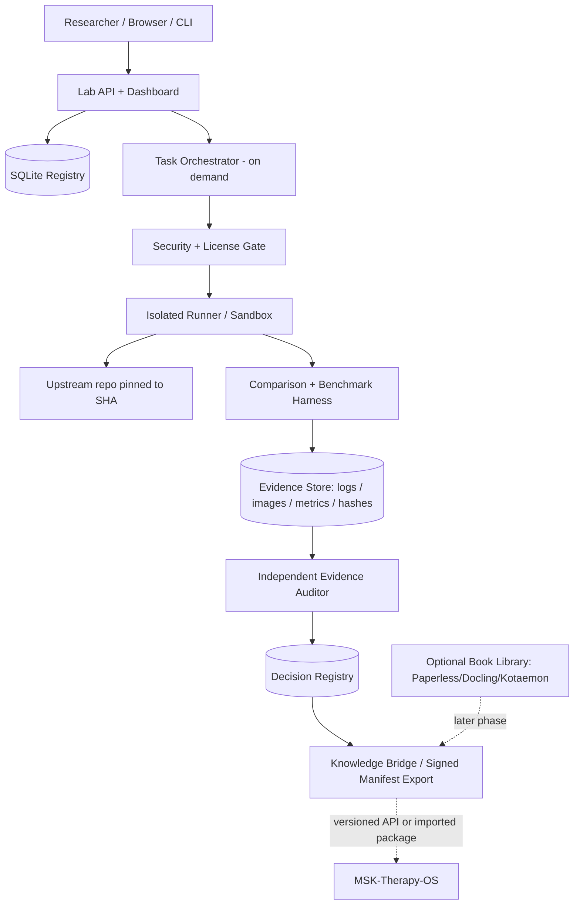

# MSK Research Lab OS

> **Product & Engineering Specification v1.0**  
> **Ngày:** 2026-10-22  
> **Trạng thái:** Proposed / Ready for implementation  
> **Loại sản phẩm:** Nền tảng nghiên cứu mã nguồn mở độc lập chạy trên Windows/WSL, **không phải hệ điều hành mới**.  
> **Dự án sử dụng kết quả (không phụ thuộc runtime):** MSK-Therapy-OS.  
> **Đối tượng đọc:** Chủ dự án, coding agent, kỹ sư tích hợp OSS, người kiểm toán kỹ thuật và cố vấn chuyên môn.

---

## 0. Quyết định kiến trúc và tóm tắt điều hành

**MSK Research Lab OS** là phòng thí nghiệm phần mềm để **khám phá → đăng ký → clone → cô lập → khởi chạy → trải nghiệm → so sánh → kiểm chứng → lưu bằng chứng → quyết định → xuất tri thức** từ các repository mã nguồn mở.

Hệ thống phải độc lập với **MSK-Therapy-OS**. Hai dự án chỉ trao đổi qua **REST API có phiên bản** hoặc **gói dữ liệu xuất bản có manifest, hash và provenance**. Nếu Research Lab dừng hoạt động, Therapy OS vẫn phải chạy bằng dữ liệu đã xuất/cached hợp lệ.

**Không tự viết lại:** Git, runtime package manager, công cụ container, OCR, trình phân tích tài liệu, browser automation, trình dựng mesh 3D, và coding agent. Lab cung cấp **quy trình nghiên cứu có thể tái lập** cùng registry, runner, benchmark và evidence, không xây lại các công cụ hiện hữu.

**Quy tắc số một:** **Một kết quả PASS không có chứng cứ kiểm tra độc lập thì không được coi là PASS.** AI có thể đề xuất kết luận, không được tự cấp chứng nhận cuối cùng.

### 0.1 Kết quả tối thiểu của MVP

Người dùng có thể:

1. Dán URL GitHub để đăng ký repository; xem metadata, branch, commit SHA, license và hồ sơ rủi ro.
2. Clone repo vào khu vực `research/upstream/` theo commit đã khóa; không chạy mã lạ khi chỉ đăng ký/clone.
3. Dùng một thao tác để **kiểm tra điều kiện**, tạo môi trường cô lập, rồi khởi chạy repo hỗ trợ theo hồ sơ adapter.
4. Trải nghiệm các UI web tại localhost được quản lý (Start/Stop/Logs/Open), chụp màn hình có metadata.
5. Chạy **benchmark `surface-registration-v1`** tuần tự trên bốn repo huyệt/kinh lạc, cùng dữ liệu và cấu hình phần cứng.
6. Xem bảng so sánh lỗi hình học, mức sử dụng RAM/CPU, ảnh, logs, license, độ tái lập và quyết định kỹ thuật.
7. Xuất **evidence package** có thể xác minh SHA-256; có thể xuất dữ liệu đã duyệt để Therapy OS đọc offline.

### 0.2 Ngoài phạm vi MVP

- Không xây OS, hypervisor, IDE, Git hosting, mô hình 3D hay LLM mới.
- Không triển khai 28 repo đồng thời; chỉ 4 repo mục tiêu và 1 Atlas chuẩn để tham chiếu.
- Không bắt buộc GPU chuyên dụng, Docker Desktop hay cloud trả phí.
- Không chẩn đoán bệnh, không chỉ định massage/châm cứu/DDS, không điều khiển thiết bị y tế.
- Không xử lý hồ sơ bệnh nhân thật hoặc dữ liệu định danh sức khỏe.
- Không tự động merge upstream vào MSK-Therapy-OS.

---

## 1. Nguyên tắc thiết kế

**Constraint-first → Artifact-first → CLI-first → Evidence-first → Cost-aware → Automation-last.**

| Nguyên tắc | Ràng buộc triển khai |
|---|---|
| Reuse before build | Dùng Git CLI, Python, SQLite, FastAPI và container runtime sẵn có; adapter thay vì fork/merge đại trà. |
| Repo ≠ product feature | Clone thành công không đồng nghĩa đã tích hợp; cần đánh giá trước khi dùng. |
| Độc lập runtime | Lab và Therapy OS chạy riêng; dữ liệu truyền qua schema/API/gói xuất bản. |
| Fail closed | Thiếu license, hash, isolation, log hoặc kết quả test bắt buộc → `BLOCKED/INCONCLUSIVE`, không PASS. |
| Deterministic by default | Cố định commit, image digest, dataset hash, tham số, seed, camera, phép đo. |
| Source-of-truth | Kết luận có link về source, commit, case ID, log, screenshot, thời điểm, môi trường và người phê duyệt. |
| Budget-aware | Laptop Windows 10, Intel i7-5600U, RAM 8GB, Intel HD 5500: tối đa **một** sandbox nặng. |
| Clinical humility | Hình học neo điểm lên mesh khác với độ đúng huyệt theo lâm sàng; hai loại kết luận không được trộn. |
| Human gate | Import/execute/đưa sang Therapy OS cần phê duyệt theo mức độ rủi ro. |

---

## 2. Người dùng và luồng sử dụng

| Vai trò | Tác vụ cần hỗ trợ |
|---|---|
| Researcher | Thêm URL, đọc mô tả, thử UI, chụp ảnh, ghi chú và so sánh. |
| Engineering owner | Xác định tập thử nghiệm, quản lý adapter, ngân sách, quyết định KEEP/ADAPT/REJECT/DEFER. |
| Security/licensing reviewer | Kiểm tra dependency, quyền, sandbox, license và giới hạn tái phân phối. |
| Clinical/domain reviewer | Xác minh thuật ngữ giải phẫu, mốc huyệt, tài liệu nguồn; nhận diện điểm chưa được kiểm chứng. |
| Coding agent | Thi hành lệnh có kiểm soát, tạo test và artifact, không tự nâng cấp verdict. |
| Consumer (Therapy OS) | Tra cứu dữ liệu được duyệt qua API hoặc import export package đã ký/xác minh hash. |

**Luồng chính:** `Discover → Register → Inspect → Approve execution → Prepare sandbox → Launch/Test → Capture evidence → Compare → Independent audit → Decision → Export`.

**Trạng thái repo:** `DISCOVERED`, `REGISTERED`, `INSPECTED`, `BLOCKED`, `READY`, `RUNNING`, `EVALUATED`, `APPROVED`, `DEFERRED`, `REJECTED`, `ARCHIVED`.

**Trạng thái phép thử:** `PENDING`, `PREPARING`, `RUNNING`, `PASS`, `FAIL`, `INCONCLUSIVE`, `BLOCKED`, `CANCELLED`. Không dùng `PASS` khi test chưa thực thi hoặc chỉ dựa vào tuyên bố trong README.

---

## 3. MVP research corpus

### 3.1 Bốn repo mục tiêu

| ID | GitHub | Vai trò trong benchmark |
|---|---|---|
| `TCM3D` | https://github.com/JICio/tcm-3d | Khảo cứu neo điểm/đường kinh lên tam giác của skin mesh, phép biến đổi tọa độ. |
| `MERIDIAN_STUDIO` | https://github.com/eb-barry/acupuncture-3d-authoring | Khảo cứu biên tập thủ công huyệt/đường kinh, raycast, JSON import/export. |
| `ANATOMY3D` | https://github.com/WaterCMY/anatomy-3d | Khảo cứu lớp mô hình, biểu diễn đường kinh, phép chiếu bề mặt. |
| `TCM_ACUPOINTS` | https://github.com/spacejohnlf/tcm-acupoints | Khảo cứu định vị/snap-to-mesh và hướng pháp tuyến. |

**Reference anchor, không tính là một trong bốn ứng viên:** https://github.com/CognitionLabSNUC/open-anatomy-atlas (model/browser và đối chiếu với BodyParts3D). Có thể cần mesh da tham chiếu khác nếu giấy phép hoặc cấu trúc upstream cản trở, nhưng mọi thay đổi tập dữ liệu phải được version hóa.

**Lưu ý:** Các mô tả trên là *giả thuyết năng lực cần kiểm tra bằng mã và bài test*, không phải kết luận kỹ thuật hay lâm sàng được chứng nhận.

### 3.2 Registry mở rộng

Duy trì catalog các nguồn thuộc: anatomical atlas, acupuncture/meridians, TCM classics/knowledge graph, massage/Tuina, motion capture, EMR/FHIR, document OCR/RAG, toolchain. Các repo Medplum, OpenMRS, 3D Slicer, Paperless-ngx, Docling, MinerU, Kotaemon, FreeMoCap, SlimeVR, OpenSim, REA... là backlog khám phá; **không nằm trong acceptance MVP**.

---

## 4. Kiến trúc logic



### 4.1 Technology choices

| Layer | MVP choice | Lý do |
|---|---|---|
| Host | Windows 10 + WSL2 Ubuntu | Khớp môi trường sử dụng; tài nguyên giới hạn. |
| Core & CLI | Python 3.11+, Typer hoặc argparse | Nhẹ, dễ debug, scripting tốt. |
| API | FastAPI + Pydantic | Validation, OpenAPI và API nội bộ. |
| Dashboard | Server-rendered HTML (Jinja2 + HTMX hoặc vanilla JS) | Tránh SPA build chain nặng khi chưa cần. |
| Persistence | SQLite WAL + FTS5 | Một người dùng, nhẹ, backup/export dễ. |
| Git | Git CLI | Không viết Git client riêng. |
| Sandbox | Ưu tiên rootless Podman; Docker Engine nếu đã được cấu hình an toàn | Giới hạn bộ nhớ, CPU, process và mạng; kiểm tra năng lực thực tế trước khi chọn. |
| Browser UI evidence | Playwright (Chromium) hoặc browser automation được cấp quyền | Screenshots và flow tests; chỉ chạy trên ứng dụng được duyệt. |
| Benchmark | Python + fixtures JSON + mesh geometry utilities | Có thể kiểm thử lặp, tạo structured metrics. |
| Artifact hashes | SHA-256 / manifest JSON | Phát hiện thay đổi tài liệu và sản phẩm. |
| Agents | ChatGPT Work/Codex/GitHub Connector qua adapter | Tận dụng năng lực sẵn có; không xây LLM orchestration framework mới. |

**Không đưa toàn bộ repo upstream vào Git repository của Lab.** `research/upstream/` là working copy được quản lý ngoài Git của Lab (`.gitignore`), hoặc theo workspace riêng. Lưu URL/SHA/license/manifest trong Registry. Không `git submodule update --init --recursive` tự động cho repo chưa đánh giá.

### 4.2 Đề xuất cây thư mục

```text
msk-research-lab-os/
├── README.md
├── SPEC.md
├── pyproject.toml
├── .gitignore
├── .env.example
├── config/
│   ├── settings.example.toml
│   ├── security-policy.yaml
│   └── budgets.yaml
├── src/msk_research_lab/
│   ├── cli.py
│   ├── api/
│   ├── dashboard/
│   ├── registry/              # repository, license, decisions
│   ├── discovery/             # GitHub metadata, scouting
│   ├── orchestrator/          # bounded jobs, 5 agent roles
│   ├── sandbox/               # runner adapters, approval gates
│   ├── adapters/              # repo-specific inspect/launch/parse
│   ├── benchmarks/            # common fixtures, metrics, replay
│   ├── evidence/              # capture, checksum, verify
│   ├── knowledge/             # indexed research outputs
│   └── bridge/                # versioned API and exports
├── manifests/
│   └── repos/                 # declarative, reviewed repo manifests
├── benchmark_suites/
│   └── surface-registration-v1/
│       ├── README.md
│       ├── fixtures/
│       ├── scenarios.yaml
│       ├── ground_truth/
│       └── scoring.py
├── research/
│   ├── upstream/              # .gitignored, immutable SHA checkouts
│   ├── workspaces/            # disposable per-run overlays
│   └── results/               # case runs and comparisons
├── data/
│   ├── registry.sqlite3       # local, .gitignored
│   ├── evidence/              # content-addressable artifacts
│   └── exports/
├── tests/
│   ├── unit/
│   ├── integration/
│   ├── sandbox/
│   └── acceptance/
└── docs/
    ├── ADR/
    ├── runbooks/
    ├── threat-model.md
    ├── license-matrix.md
    └── handoffs/
```

---

## 5. Chức năng hệ thống và yêu cầu nghiệm thu

### FR-01. Repo Discovery & Research Registry

- Thêm GitHub URL; chuẩn hóa owner/repo, tránh trùng lặp.
- Thu metadata: upstream URL, default branch, commit SHA, ngày kiểm tra, last update, dependency stack, license ID/file hash, entrypoint, kích thước dự kiến, link issue/documentation.
- Lưu scorecard SWOT có **nội dung định tính + evidence URL/ID**; không biến SWOT tự động thành điểm chính xác giả tạo.
- Cho phép thêm repo mới mà không phải sửa core. Registry lưu thông tin về từng revision, không ghi đè lịch sử quyết định.
- Đăng ký hoặc clone **không** tự kích hoạt script cài đặt/build/test của upstream.

**Acceptance:** đăng ký cùng URL hai lần không tạo bản ghi trùng; pin được SHA; phát hiện license chưa xác định và buộc trạng thái `REVIEW_REQUIRED`.

### FR-02. Environment Discovery & Safe Clone

- Kiểm tra `git`, `python`, `node`, `wsl`, browser, container runtime; hiển thị `available/missing/unsupported`.
- Clone dùng Git CLI và SHA pin, hạn chế tải lớn; mặc định không LFS và không submodule tự động. Ghi log lệnh, return code, SHA thực tế.
- Không dùng shell command ghép từ chuỗi URL chưa kiểm tra; tham số hóa subprocess (`shell=False`).
- Paths nằm trong root đã cho phép; ngăn `../`, symlink traversal, ghi ngoài workspace.
- Kiểm tra repo trước khi chạy `npm install`, `pip install`, `postinstall`, `make`, notebook hoặc binary.

**Acceptance:** commit mismatch hoặc checkout không thể xác minh → `BLOCKED`; clone không chạy package scripts.

### FR-03. Sandbox Isolation & Resource Governor

**Mô hình đe dọa:** repo và dependencies có thể thực thi code độc hại, truy cập mạng/host, ghi file, tiêu thụ tài nguyên hoặc đọc dữ liệu cá nhân. **WSL đơn thuần không được coi là sandbox an ninh hoàn chỉnh.**

- Mặc định **deny execution** tới khi repo được inspect và owner chấp thuận môi trường.
- Mỗi lần chạy dùng workspace disposable, user không có root, filesystem read-only nơi thích hợp; chỉ writable volume cần thiết; **không mount `C:\Users`, hồ sơ bệnh án, SSH key, token, `.gitconfig` nhạy cảm hoặc Docker socket**.
- Giới hạn gợi ý ban đầu: `memory <= 2 GiB / run`, `cpus <= 1.5`, `pids <= 128`, timeout có cấu hình; điều chỉnh theo tài nguyên còn trống và phương pháp chạy.
- Drop Linux capabilities; `no-new-privileges`; profile seccomp hợp lý; tắt privileged mode; network `none` mặc định khi thực thi benchmark offline.
- Nếu cần tải dependencies: bước fetch/build riêng có duyệt allowlist outbound và lưu provenance; runtime test lại **offline** nếu khả thi.
- Các ứng dụng web muốn xem trên host dùng loopback port được quản lý, proxy/tunnel **chỉ sau khi kiểm tra rủi ro**; không mở cổng `0.0.0.0` theo mặc định.
- Nếu không có container runtime đáp ứng kiểm soát: **chỉ inspect tĩnh**, đánh dấu `SANDBOX_UNAVAILABLE`; không chạy trực tiếp trên Windows để giả vờ đạt acceptance.
- Một sandbox nặng tại một thời điểm. Stop/kill phải dọn process tree, cổng, temporary volumes và secrets.

**Acceptance:** test vượt RAM/CPU/time bị dừng và có log; test cố gắng ghi host path hoặc liên lạc Internet khi `network=none` phải thất bại. Kiểm tra cấu hình isolation trước mỗi execution.

### FR-04. Launcher & Experience Dashboard

- Hiển thị danh sách repo: inspected/ready/running/blocked, loại UI (web/desktop/CLI/asset-only), last run, license, verdict.
- Start/Stop/Open/Logs/Screenshot hoạt động cho adapter hỗ trợ. Không hiển thị nút Start có thể nhấn nếu repo chỉ là dataset hoặc không hỗ trợ môi trường máy.
- Phân biệt rõ `STARTED`, `HEALTHY`, `RENDERED`, `VISUALLY_VERIFIED`; HTTP 200 không chứng minh giao diện đã vẽ đúng.
- Lưu screenshot có URL cục bộ, viewport, thời điểm, repo SHA, run ID; screenshot không chứa dữ liệu cá nhân.

**Acceptance:** launch ít nhất 1 repo web có ảnh UI thực, kiểm chứng tương tác điều khiển và đóng sạch tiến trình. Nếu 4 repo có loại sản phẩm khác nhau, không ép tất cả thành web app giả.

### FR-05. Comparison Engine

- Một **benchmark suite versioned** với cùng chuẩn đầu vào, cùng mesh, cùng landmarks, cùng camera, cùng tham số, cùng hardware và điểm đo.
- Adapter repo dịch dữ liệu sang schema chuẩn; lưu rõ phép đổi đơn vị, trục tọa độ, scale, handedness, mirror/left-right, mesh topology và hệ phiên bản.
- Dựng đối chiếu trường hợp **không khả dụng/not comparable** thay vì ép tính điểm gây hiểu sai.
- Có run-by-run diff, screenshots trước/sau, metric distribution và raw outputs.

**Acceptance:** tái chạy từ manifest trên sandbox sạch, kết quả hợp lệ và báo cáo có version, sai số, nguồn, giới hạn so sánh.

### FR-06. Evidence Registry & Independent Audit

- Mỗi run xuất artifact bắt buộc: source SHA, `environment.json`, `commands.json`, `stdout.log`, `stderr.log`, `metrics.json`, `results.json`, ảnh (nếu UI), và `sha256-manifest.json`.
- Evidence files phải bất biến sau khi finalized; thay đổi tạo run/revision mới; verify checksums trước khi hiển thị verdict.
- Mỗi kết luận `PASS` trỏ tới assertion + measured value + criterion + evidence path/hash.
- Auditor không thể là thành phần duy nhất chứng nhận chính benchmark mà nó chạy; phân cấp: automated validation + independent rerun/review + owner approval khi xuất sang Therapy OS.

**Acceptance:** xóa/sửa bất kỳ evidence file khiến `evidence verify` thất bại và verdict chuyển thành `INVALID_EVIDENCE` cho tới khi xử lý.

### FR-07. Decision Registry

- Kết quả kỹ thuật `KEEP`, `ADAPT`, `REJECT`, `DEFER` cùng rationale, evidence IDs, người duyệt, ngày, phiên bản và ràng buộc license.
- Separate verdicts: `technical_pass`, `security_review`, `license_review`, `domain_review`, `clinical_validation_status`.
- `surface geometry PASS` không tự đồng nghĩa `acupoint clinical validation PASS`.

**Acceptance:** không thể publish adapter/data vào export bridge khi license chưa duyệt hoặc thiếu independent audit.

### FR-08. Knowledge Bridge

Hai cách tích hợp **đồng thời**:

1. **Offline package (ưu tiên MVP):** Zip/dir JSON/CSV/PNG và `manifest.json`, schema version, nguồn, provenance, license, SHA-256, loại nội dung, expert-review status. MSK-Therapy-OS import bản đã duyệt. Lab không cần chạy khi người dùng Therapy OS tra cứu.
2. **Read-only REST API (tùy chọn runtime):** `/api/v1/knowledge/...`, `/api/v1/evidence/...` và pagination/filter; chỉ trả nội dung được phép export. API ràng buộc localhost/token, giới hạn request; không cấp API viết dữ liệu bệnh nhân từ Therapy OS sang Lab.

**Acceptance:** tắt hoàn toàn Lab, Therapy OS vẫn đọc được package export cũ; package bị sửa hash phải bị từ chối khi import.

### FR-09. Document Knowledge Library (giai đoạn sau MVP)

Tái sử dụng [Paperless-ngx](https://github.com/paperless-ngx/paperless-ngx) + [Docling](https://github.com/docling-project/docling) + [Kotaemon](https://github.com/Cinnamon/kotaemon); dùng [MinerU](https://github.com/opendatalab/MinerU) khi gặp trang scan khó.

- Import EPUB/PDF/DOCX; giữ nguyên binary gốc, hash và quyền sử dụng; OCR chỉ là một lớp dữ liệu dẫn xuất.
- Index trang/chương/đoạn, ảnh, sơ đồ, bảng, captions, liên kết bounding box và ảnh trang gốc; đánh dấu OCR confidence hoặc status cần review.
- Tìm kiếm từ khóa trước (FTS5), ngữ nghĩa sau; RAG trả citation chính xác file, trang, đoạn và ảnh nguồn.
- Xác minh **page coverage**: số trang phát hiện vs số trang xử lý; report hình/bảng bị bỏ sót; cho phép reviewer mở trang gốc đối chiếu.
- Tách `traditional_claim`, `anatomical_fact`, `clinical_evidence`, `hypothesis`, `personal_note`. Không tự chuyển mô tả cổ truyền thành cơ chế y khoa xác nhận.
- Không index/chia sẻ sách có bản quyền ra bên ngoài khi không có quyền; local-first, không gửi nội dung sách lên dịch vụ AI ngoài khi chưa được phép.

**Acceptance tương lai:** benchmark riêng trên PDF scan có hình, bảng, sơ đồ; không dùng chỉ số “AI trả lời trôi chảy” làm bằng chứng đã đọc hết sách.

---

## 6. Agent Orchestrator: 5 vai trò, không chạy thường trực

**Không** khởi tạo 5 model luôn mở. Orchestrator là **job queue hữu hạn** với trạng thái/giới hạn quota; mỗi vai trò được gọi theo nhu cầu và có thể do cùng một coding agent thực hiện ở các lượt độc lập. Bằng chứng và phê duyệt không được phụ thuộc vào memory hội thoại.

| Role | Input | Output bắt buộc | Không được làm |
|---|---|---|---|
| **Scout** | URL/từ khóa và yêu cầu nghiên cứu | Candidate profile, metadata, capability claims, URL dẫn chứng | Khẳng định repo chạy được khi chưa run |
| **Security** | Repo revision, dependencies, proposed commands | License report, risk flags, policy decision | Mặc định cho phép chạy script lạ |
| **Runner** | Approved manifest, sandbox config, benchmark | Run ID, raw metrics/logs/screenshots, exit statuses | Tự phê chuẩn PASS cuối cùng |
| **Comparator** | ≥2 valid runs, normalized fixtures | Bảng sai số, unfair-comparison flags, SWOT/evidence | Bỏ qua incompatibility và ép mọi repo cùng hạng |
| **Auditor** | Raw evidence, constraints, independent replay | Verified/inconclusive/rejected assertion, audit report | Xác nhận bằng nhận xét chung chung hoặc tự công nhận kết luận mình tạo |

**Cơ chế bắt buộc:** bounded tokens/time/cost; retries có giới hạn; circuit breaker khi quota hết; job idempotent; full audit trail; không thao tác ngầm ngoài phiên có quyền; không phê duyệt promotion bằng lời nói của agent.

**Giai đoạn M0–M2:** có thể dùng CLI thủ công hoặc coding agent hiện hữu. Chỉ bật auto-orchestration sau khi quy trình thủ công đã có test ổn định.

---

## 7. Benchmark `surface-registration-v1`

### 7.1 Mục tiêu

Đánh giá khả năng ánh xạ tọa độ điểm/đường kinh lên **bề mặt mesh 3D** và giữ đúng khi thay đổi góc nhìn, vị trí vùng giải phẫu hoặc dữ liệu đầu vào. **Không tự chứng nhận vị trí huyệt đúng theo chuyên môn.**

### 7.2 Fixture bắt buộc

- `mesh_reference.glb` (hoặc OBJ chuẩn) có hash SHA-256, license, unit, handedness, topology, landmark IDs rõ ràng.
- `points_reference.json`: point IDs, nguồn gốc tọa độ, vùng cơ thể, laterality, initial coordinates, expected geometry relations.
- `camera_presets.json`: anterior/posterior/left/right, neck–shoulder, head, upper limb, lower limb; cùng độ phân giải viewport.
- `scenarios.yaml`: điều kiện đầu vào, phép đo, thresholds và negative-control cases.
- `hardware.json`: Windows build, WSL/kernel, CPU, total RAM, browser/WebGL renderer, runtime versions.

Nếu upstream không hỗ trợ mesh reference vì format, benchmark có thể dùng adapter chuyển đổi có provenance; không chỉnh sửa âm thầm dữ liệu nguồn. Ghi nhận rõ transform matrix, unit scale và điểm không thể so sánh.

### 7.3 Test cases

| Test ID | Bài kiểm thử | Kết quả kỳ vọng |
|---|---|---|
| `SR-01` | Import cùng mesh và canonical points | Transform, units, axes được log; không silently rescale/mirror. |
| `SR-02` | Project/snap points to surface | Khoảng cách signed/unsigned đến surface trong tolerance được định nghĩa theo fixture. |
| `SR-03` | Surface anchor persistence | Điểm giữ quan hệ với tam giác/barycentric sau biến đổi mô hình hợp lệ. |
| `SR-04` | Polyline registration | Sai số đường kinh được đo; không cắt qua các vùng cấm bởi fixture. |
| `SR-05` | Laterality & mirror | Không hoán đổi trái/phải; bắt được testcase có tọa độ bị mirror. |
| `SR-06` | Region filtering & selection | Chọn cổ–vai không hiển thị toàn thân sai quy tắc; selection khớp structure. |
| `SR-07` | Occlusion & visual inspection | Điểm sau mesh không nổi xuyên da; screenshot front/side/back có review. |
| `SR-08` | Negative controls | Input sai đơn vị, trục, rotation, NaN, out-of-bounds bị báo lỗi. |
| `SR-09` | Resource use | Thu peak process/container RAM, CPU, browser process và GPU khả dụng; không lấy JS heap làm tổng RAM. |
| `SR-10` | Reproducibility | Chạy 3 lần trong môi trường sạch với pinned SHA/fixtures; so sánh kết quả. |

**Thresholds:** Không gán mặc định “2 mm = đúng huyệt” trên mô hình tham chiếu. Geometric tolerance được xác định theo **sai số phép tính + scale mesh + fixture**, lưu bằng version riêng trong `scenarios.yaml`. Chỉ dùng clinical landmark accuracy sau khi có dữ liệu chuẩn do chuyên gia có thẩm quyền xác minh.

### 7.4 Kết quả so sánh

Mỗi repo ghi: mức hỗ trợ test (`SUPPORTED/ADAPTED/UNSUPPORTED`), số lần chạy, pass/fail/inconclusive per case, RMS/max surface distance (nếu hợp lệ), ratio invalid points, left/right mismatch, screenshot review, time-to-first-render, peak RSS/container memory, license status, limitations. Tổng điểm chỉ hiển thị khi metric tương đương và mẫu test công bằng; **không xếp hạng dựa trên số liệu thiếu**.

### 7.5 Ba tầng xác thực

1. **Deterministic geometry tests** (tự động): trục, khoảng cách, transform, topology, mirror.
2. **Visual QA** (ảnh và tương tác): camera, occlusion, select/region, phản ánh giao diện chạy thật.
3. **Domain expert validation** (ngoài MVP): vị trí huyệt và ý nghĩa chuyên môn, có nguồn và chữ ký reviewer.

---

## 8. Data model tối thiểu

| Table | Khóa và trường trọng yếu |
|---|---|
| `repositories` | `id`, `full_name`, `source_url`, `description`, `category`, `created_at` |
| `repo_revisions` | `id`, `repo_id`, `commit_sha`, `branch`, `license_spdx`, `license_file_sha256`, `inspected_at`, `status` |
| `repo_adapters` | `id`, `repo_revision_id`, `adapter_version`, `capabilities_json`, `approved_commands_json` |
| `risk_reviews` | `id`, `revision_id`, `sandbox_approval`, `license_decision`, `risk_level`, `reviewer`, `notes` |
| `benchmark_suites` | `id`, `version`, `fixture_sha256`, `scenario_sha256`, `description` |
| `experiments` | `id`, `suite_id`, `revision_id`, `status`, `created_at`, `run_config_sha256` |
| `runs` | `id`, `experiment_id`, `run_no`, `started_at`, `ended_at`, `environment_sha256`, `exit_code`, `status` |
| `measurements` | `id`, `run_id`, `metric`, `value`, `unit`, `test_case`, `method` |
| `artifacts` | `id`, `run_id`, `type`, `relative_path`, `sha256`, `size`, `created_at` |
| `audit_results` | `id`, `run_id`, `auditor`, `assertion`, `verdict`, `evidence_ids_json`, `reason` |
| `decisions` | `id`, `revision_id`, `decision`, `approver`, `approved_at`, `evidence_refs_json`, `rationale` |
| `exports` | `id`, `version`, `package_path`, `manifest_sha256`, `approval_id`, `created_at` |

**Dữ liệu bất biến:** revisions, finalized run artifacts, decisions và exports không bị overwrite; chỉ bổ sung revision/review mới. Migrations có version, backup dữ liệu trước khi đổi schema.

### 8.1 Evidence run layout

```text
data/evidence/<run_id>/
├── source.json              # repo URL + commit SHA + licensing
├── environment.json         # OS, CPU, RAM, runtime/image digest
├── commands.json            # exact commands with secret redaction
├── stdout.log
├── stderr.log
├── metrics.json             # raw measurements + units
├── results.json             # assertions, criteria, status
├── captures/
│   ├── anterior.png
│   ├── lateral.png
│   └── posterior.png
├── audit.json               # independent audit outcome
└── sha256-manifest.json     # hash of all immutable artifacts
```

### 8.2 Schema minh họa cho evidence record

```json
{
  "schema_version": "1.0",
  "run_id": "RUN-20261022-0001",
  "repository": "JICio/tcm-3d",
  "commit_sha": "<real-40-hex-from-git>",
  "benchmark": "surface-registration-v1",
  "fixture_sha256": "<actual-sha256>",
  "assertion": "SR-05-left-right-consistency",
  "status": "INCONCLUSIVE",
  "measured": null,
  "criterion": "No left/right swaps in validated fixture",
  "evidence_files": ["results.json", "captures/anterior.png"],
  "audited_by": null,
  "limitations": ["Awaiting independent verification"]
}
```

---

## 9. API & CLI contract

### 9.1 REST API đề xuất

| Method + route | Ý nghĩa |
|---|---|
| `POST /api/v1/repos` | Đăng ký URL, chưa thực thi upstream code. |
| `GET /api/v1/repos` | Liệt kê/tìm theo category/status/license. |
| `GET /api/v1/repos/{id}` | Thông tin và revision history. |
| `POST /api/v1/repos/{id}/inspect` | Scan metadata, license, dependencies, proposed commands. |
| `POST /api/v1/repos/{id}/clone` | Clone pinned SHA sau validation. |
| `POST /api/v1/revisions/{id}/approve-execution` | Chủ sở hữu duyệt các điều kiện runtime. |
| `POST /api/v1/benchmarks/runs` | Yêu cầu benchmark theo suite/targets, hàng đợi tuần tự. |
| `GET /api/v1/runs/{id}` | Trạng thái, metrics, evidence links. |
| `POST /api/v1/runs/{id}/audit` | Kiểm tra evidence/independent replay. |
| `GET /api/v1/comparisons?benchmark=...` | So sánh hợp lệ và cảnh báo incompatibility. |
| `POST /api/v1/decisions` | Đề xuất quyết định; approval role riêng. |
| `POST /api/v1/exports` | Xuất approved evidence/knowledge package. |
| `GET /api/v1/knowledge/{namespace}/{id}` | Tra cứu knowledge bản đã approved, readonly. |

Các route thực thi, duyệt và xuất đều có **role authorization**, audit logs và idempotency key nếu thích hợp. Bản MVP chạy localhost, nhưng localhost **không thay thế xác thực** với API nguy hiểm.

### 9.2 CLI tối thiểu

```bash
mskrl doctor
mskrl init
mskrl repo add https://github.com/JICio/tcm-3d
mskrl repo inspect JICio/tcm-3d
mskrl repo clone JICio/tcm-3d --sha <reviewed-commit-sha>
mskrl sandbox check
mskrl lab start --repo JICio/tcm-3d --revision <id>  # requires approval
mskrl lab stop --run <run-id>
mskrl bench run surface-registration-v1 --targets TCM3D,MERIDIAN_STUDIO,ANATOMY3D,TCM_ACUPOINTS --sequential
mskrl bench compare surface-registration-v1
mskrl evidence verify --run <run-id>
mskrl decision propose --revision <id> --value ADAPT --evidence <run-id>
mskrl export package --revision <approved-revision-id> --format json
mskrl serve --host 127.0.0.1 --port 8765
```

CLI dùng được không cần dashboard. Demo mode có mock repo và fixture nhỏ để CI chạy ngay cả khi không có mạng/GPU.

---

## 10. Security, privacy, IP và clinical guardrails

### 10.1 Security controls

- Đánh giá mô hình đe dọa trước khi cho runner có quyền thực thi; public GitHub không đồng nghĩa an toàn.
- Repo upstream chỉ được truy cập bản readonly; không có cloud credentials hoặc host secrets trong sandbox.
- Pin version và verify cryptographic hashes; phân tích dependency, scripts, SBOM khi khả thi.
- Network disabled by default; allowlist download ở giai đoạn riêng; ghi tất cả outbound exceptions.
- Cần kiểm tra license từng repo **và** dataset/3D mesh/assets của repo; license code không tự cấp quyền dùng dữ liệu y khoa/sách/hình.
- Sách PDF/EPUB/DOCX có bản quyền phải lưu local, tuân thủ quyền sử dụng và không tự xuất văn bản/hình đầy đủ vào gói công khai.
- Dữ liệu demo/synthetic; không nhập thông tin bệnh nhân thật khi chưa có quy trình quyền riêng tư và pháp lý phù hợp.

### 10.2 Clinical guardrails

- Nhãn phân biệt `Traditional theory`, `Anatomical structure`, `Empirical evidence`, `Clinical guideline`, `Hypothesis`.
- Cần chuyên gia kiểm tra khi công bố vị trí huyệt/kinh lạc là chuẩn; không suy ra “khai thông kinh lạc” từ ảnh hoặc giá trị hình học.
- Không tự động đề xuất chỉ định điều trị, mức điện DDS hoặc thủ thuật nguy hiểm. Bản MVP chỉ hỗ trợ nghiên cứu và giáo dục.

---

## 11. KPI và phương pháp tính

| KPI | Định nghĩa | Quy tắc đo |
|---|---|---|
| **TTVD** (*Time To Verified Decision*) | `t_approved_decision - t_repo_registered`; tính median và P90. | Chỉ tính verdict có evidence, license/security review và independent audit; chưa duyệt không được coi hoàn tất. |
| **Reproducibility Rate** | Số bài test tái lập đạt tiêu chí / số bài test hợp lệ được chọn để tái lập. | Mỗi case cần fresh environment, pinned inputs, tối thiểu 3 runs khi đánh giá định lượng. Report cả mẫu số và loại trừ. |
| **False Acceptance Rate** | Số quyết định PASS/APPROVED bị kiểm toán độc lập bác bỏ / tổng PASS/APPROVED được lấy mẫu kiểm toán. | Phải audit định kỳ và lưu lý do; khi mẫu số = 0 hiển thị `N/A`, không hiển thị 0%. |
| **Evidence Completeness** | Số runs có đủ artifacts bắt buộc và hash hợp lệ / tổng finalized runs. | Target: 100%; thiếu artifact không finalized. |
| **Sandbox Enforcement** | Số negative tests cách ly bị chặn / số negative tests đã chạy. | Target: 100% cho kiểm thử mức bắt buộc. |
| **Resource Budget** | Peak WSL/host RAM, container memory, CPU; hiệu năng browser/GPU khi đo được. | Kiểm tra under 8GB host budget; browser process + WSL + host, không dùng JS heap thay thế. |

**MVP success gates:** chạy ít nhất một adapter thực với bằng chứng UI/CLI; cả bốn repo có `INSPECTED` và review rõ ràng; benchmark suite chạy trên **tất cả repo hỗ trợ** (unsupported phải có lý do), ít nhất một bộ test negative controls, evidence verify thành công; report có ít nhất hai repo so sánh trên metric tương thích. Không dùng KPI nhân tạo khi mẫu quá ít.

---

## 12. Milestones và Definition of Done

### M0 — Foundation & threat model

**Đầu ra:** repo độc lập, SPEC, README, CLI `doctor`, SQLite migrations, Git URL normalization, lifecycle, dashboard skeleton, threat model, security policies, sample fixtures.

**DoD:** `pytest` cho schema, URL validation, dedup, state machine; `mskrl doctor` hiển thị trung thực môi trường Windows/WSL; file README có CLI instructions.

### M1 — Registry, inspected clone, sandbox

**Đầu ra:** Repo Registry, safe clone pin SHA, license flags, dependency profile, sandbox adapter, resource limits, approved commands, audit log.

**DoD:** negative sandbox tests; một repo clone đúng SHA; không được chạy upstream nếu sandbox chưa sẵn sàng; chạy và dừng sạch một test sample trong cô lập.

### M2 — Four-repo research benchmark

**Đầu ra:** inspect 4 repo, adapter ít nhất cho repo có thể thực thi, canonical fixtures, surface registration suite, screenshots, RAM benchmark, comparisons và `INCONCLUSIVE` rõ ràng.

**DoD:** 10 test IDs hoặc documented unsupported, >=2 repo có metric tương thích thực, full evidence manifest, negative controls, snapshots thực được review; không tuyên bố vị trí huyệt đúng chuyên môn.

### M3 — Evidence audit & Knowledge Bridge

**Đầu ra:** independent verifier, decision approval, offline export/import contract, read-only API, provenance/terms review.

**DoD:** sửa đổi evidence làm verify fail; unapproved package bị chặn; import offline thành công ở mock consumer ngay cả khi Lab không chạy.

### M4 — Optional agent orchestration and book library

**Đầu ra:** 5 logical agents theo job, bounded quota; tài liệu Paperless/Docling/Kotaemon; OCR completeness benchmark và Knowledge Search.

**DoD:** được triển khai chỉ khi M0–M3 đạt, có baseline trước/sau automation, rollback; RAG trả citation trang và ảnh gốc, không tạo citation giả.

---

## 13. Acceptance checklist chống báo cáo PASS giả

Trước khi coding agent báo hoàn thành milestone:

- [ ] Có `git status`, commit SHA của chính Lab và upstream SHA của từng repo.
- [ ] Liệt kê file thực sự thêm/sửa; không chỉ mô tả kế hoạch.
- [ ] Chạy lệnh test trong môi trường được chỉ rõ, đính kèm stdout/stderr và exit code.
- [ ] Report có tổng số PASS/FAIL/SKIP/BLOCKED/INCONCLUSIVE, không gom SKIP vào PASS.
- [ ] Screenshot UI **thật** với URL, viewport và thao tác chọn vùng/camera đã kiểm chứng.
- [ ] Kết quả geometry dùng fixture được hash; lỗi mirror/offset/occlusion được phát hiện bằng negative controls.
- [ ] Resource measurement có peak host/WSL/container/browser khi khả thi; ghi khi không đo được GPU.
- [ ] License, code/data provenance và security review tách biệt.
- [ ] Evidence hashes được verify độc lập sau run.
- [ ] Không chạm vào repo `msk-therapy-os` hoặc hồ sơ người dùng nếu chưa có task/phê duyệt rõ ràng.
- [ ] Có rollback và handoff để tiếp tục trong session mới.

**Hoàn thành thật = feature + tests + evidence + được review.** Những thứ còn `BLOCKED` hoặc `INCONCLUSIVE` phải được trình bày đúng trạng thái.

---

## 14. Thứ tự thi công đề xuất cho coding agent

1. Khởi tạo `msk-research-lab-os` **ở đường dẫn riêng** với `msk-therapy-os` (ví dụ `D:\5Projects\msk-research-lab-os`), không sửa dự án Therapy.
2. Chạy `doctor`, kiểm tra Windows/WSL, RAM, disk, Git, Python, sandbox runtime, browser; ghi evidence môi trường.
3. Dựng Registry + migrations + CLI tối thiểu. Tạo seed manifest cho 4 repo; không chạy tự động.
4. Dựng security gate + sandbox adapter + negative test harness. Nếu thiếu isolation, dừng ở static inspection và báo BLOCKED.
5. Xây một adapter end-to-end có thể chạy thật; chụp UI hoặc CLI transcript.
6. Chuẩn hóa fixture `surface-registration-v1`, adapters cho repo còn lại, đo metric và ghi non-comparable khi cần.
7. Xây evidence verify + auditor + decision registry và dashboard so sánh.
8. Làm Knowledge Bridge offline trước, REST API sau.
9. Chỉ sau khi có đo TTVD/reproducibility baseline mới thử auto-orchestrator và document library.

### Prompt ngắn để bắt đầu phiên coding agent

> Implement M0 and M1 of `MSK Research Lab OS` according to `MSK_RESEARCH_LAB_OS_SPEC_v1.0.md`. Create a new standalone repo; do not modify `msk-therapy-os`. Use reuse-first, CLI-first, explicit safe-clone, sandbox approval and evidence-driven acceptance. Inspect host/WSL constraints before choosing a runtime. If adequate isolation is unavailable, implement inspect-only mode and report BLOCKED instead of executing upstream code. Deliver real source files, runnable tests, commands, exit codes, evidence artifacts, commits, a concise handoff, and accurate PASS/FAIL/INCONCLUSIVE counts. Do not implement future milestones or claim clinical validity.

---

## 15. Risk register

| Rủi ro | Xác suất/ảnh hưởng | Đối sách |
|---|---|---|
| Mã từ repo lạ độc hại | Cao / Cao | Inspect-only default, sandbox, deny network, least privilege, reviewed entrypoint. |
| WSL không thực sự cách ly host | Trung bình / Cao | Không coi WSL là security sandbox; fail closed nếu không đủ isolation. |
| RAM 8GB/OOM | Cao / Trung bình | Sequential runner, cgroup budget, hard timeout, avoid simultaneous browser/3D workloads. |
| Không thống nhất tọa độ 3D | Cao / Cao | Provenance transform, canonical fixtures, negative controls, metric comparability flags. |
| Sai lệch giải phẫu/huyệt | Cao / Cao | Separate geometry/clinical layers, professional review, no autonomous therapy decisions. |
| License không tương thích | Trung bình / Cao | License per code/data/mesh/book; legal review before redistribution/promotion. |
| Agent tạo test/screenshot giả | Trung bình / Cao | Hash artifacts, independent rerun, browser-visible QA, audit trail. |
| OCR bỏ sót hình/bảng | Cao / Trung bình | Page coverage audit, preserved source pages, multimodal review, not PDF-text-only. |
| Phụ thuộc runtime giữa Lab và Therapy | Trung bình / Cao | Offline package default, API optional, consumer isolation test. |

---

## 16. Những câu hỏi kỹ thuật cần kiểm tra thực địa (không làm blocker cho M0)

- WSL2 hiện có container runtime đủ mạnh và phù hợp giấy phép/cấu hình không?
- Có thể cấp virtualized sandbox thực sự hay chỉ cgroup/process isolation? Đây là mức độ rủi ro khác nhau.
- Phiên bản Node/Python/Three.js, data size và license cụ thể của từng revision 4 repo là gì?
- Skin mesh dùng benchmark có thể tái phân phối trong evidence package không?
- Nguồn ground truth nào có clinician-approved surface landmarks để đánh giá **clinical validity** ở giai đoạn sau?
- Có cần hỗ trợ Windows native desktop repo và cấu hình GPU passthrough không? Nếu chưa có sandbox an toàn, MVP cho phép **inspect-only**.
- Khi triển khai Knowledge Library, phạm vi quyền sử dụng EPUB/PDF/DOCX và lựa chọn OCR chạy local là gì?

**Quyết định cuối:** MVP ưu tiên luồng thực sự tái lập được từ một repo và một benchmark, sau đó mở rộng. Không dành thời gian tạo dashboard hoàn mỹ trong khi Registry, Sandbox và Evidence chưa đáng tin.
