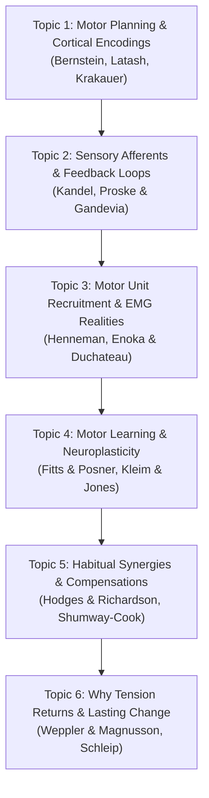

# P15 Motor Control, Sensory Feedback & Movement Neuroplasticity
**MSK Research Lab OS — Milestone P15**  
**Role:** Interactive Learning Architect, Motor Control Neurophysiologist  
**Date:** 2026-10-31  
**Module:** [`shoulder_lab.py`](file:///mnt/c/Users/tuanh/Downloads/msk-research-lab/src/msk_research_lab/biomechanics/shoulder_lab.py) / [`workstation_ui.py`](file:///mnt/c/Users/tuanh/Downloads/msk-research-lab/src/msk_research_lab/api/workstation_ui.py)

---

## 1. The Central Educational Inquiry

> **Central Case Study Question:**  
> *Why can shoulder muscle tension temporarily improve after manual muscle treatment while a familiar posture or movement pattern later returns?*

Milestone P15 addresses this fundamental clinical and pedagogical problem through **6 evidence-based educational topics** grounded in neuromuscular physiology, motor control, and motor learning science.

---

## 2. Six Evidence-Based Motor Control Topics

### Topic 1: Motor Planning, Cortical Encodings & Movement Coordination
- **Topic ID:** `motor_planning_and_coordination`
- **Core Concept:** Voluntary movements are not controlled as isolated individual muscles. The central nervous system (CNS) resolves Bernstein's degrees-of-freedom problem by organizing muscles into coordinated functional synergies.
- **Key References:**
  - Bernstein NA. *The Co-ordination and Regulation of Movements.* Pergamon Press; 1967.
  - Latash ML. *Fundamentals of Motor Control.* Academic Press; 2012.
  - Krakauer JW, et al. *Motor learning.* Compr Physiol. 2019;9(2):613-663.

### Topic 2: Proprioceptive Feedback: Spindles, GTOs & Sensorimotor Loops
- **Topic ID:** `sensory_feedback_proprioception`
- **Core Concept:** Intrafusal muscle spindles (Ia/II afferents) monitor fiber length and velocity; Golgi tendon organs (Ib afferents) monitor mechanical tension. Gamma-motor neuron co-activation maintains spindle sensitivity during voluntary contraction.
- **Key References:**
  - Kandel ER, et al. *Principles of Neural Science.* 6th ed. McGraw-Hill; 2021.
  - Proske U, Gandevia SC. *The proprioceptive senses.* Physiol Rev. 2012;92(4):1651-1697.

### Topic 3: Muscle Activation, Motor Unit Recruitment & EMG Realities
- **Topic ID:** `muscle_activation_motor_unit_recruitment`
- **Core Concept:** Henneman's size principle dictates orderly recruitment of slow-twitch fatigue-resistant motor units prior to high-threshold fast units. Crucially, electrical activation (EMG) measures depolarization, NOT passive tissue stiffness. High passive tension can occur in electrically silent muscles due to connective tissue and titin elongation.
- **Key References:**
  - Henneman E, et al. *Functional significance of cell size in spinal motoneurons.* J Neurophysiol. 1965;28(3):560-580.
  - Enoka RM, Duchateau J. *Rate coding and the control of muscle force.* Cold Spring Harb Perspect Med. 2017;7(10):a029702.

### Topic 4: Movement Practice, Motor Learning Stages & Neuroplastic Adaptation
- **Topic ID:** `motor_learning_neuroplasticity`
- **Core Concept:** Modifying motor behavior proceeds through Fitts & Posner's 3 stages: Cognitive (conscious, cue-dependent) $\to$ Associative (refining, proprioceptive integration) $\to$ Autonomous (automatic). Deliberate active practice drives long-term potentiation (LTP), dendritic synaptogenesis, and somatotopic map reorganization in primary motor cortex (M1).
- **Key References:**
  - Kleim JA, Jones TA. *Principles of experience-dependent neural plasticity.* J Speech Lang Hear Res. 2008;51(1):S225-S239.
  - Schmidt RA, Lee TD. *Motor Learning and Performance.* 6th ed. Human Kinetics; 2019.

### Topic 5: Habitual Movement Patterns, Compensatory Synergies & Postural Encodings
- **Topic ID:** `habitual_movement_patterns_synergies`
- **Core Concept:** The nervous system prioritizes immediate task completion and metabolic efficiency over idealized mechanical symmetry. Under prolonged environmental constraints (e.g., desk ergonomics) or previous pain, the brain consolidates compensatory synergies (e.g., upper trapezius over-activation compensating for serratus anterior deficit).
- **Key References:**
  - Hodges PW, Richardson CA. *Inefficient muscular stabilization.* Spine. 1996;21(22):2640-2650.
  - Shumway-Cook A, Woollacott MH. *Motor Control: Translating Research into Clinical Practice.* 6th ed. 2023.

### Topic 6: Why Temporary Muscle Tension Relief Does Not Equal Lasting Coordination Change
- **Topic ID:** `transient_tone_relief_vs_coordination`
- **The Epistemic Resolution:**
  1. *Why tension decreases temporarily:* Manual therapy, massage, and passive stretching induce transient **viscoelastic stress-relaxation**, **thixotropic fluidification** of hyaluronic acid in the extracellular matrix, and temporary autonomic down-regulation of gamma-motor neuron drive.
  2. *Why habitual tension returns:* Passive inputs **do NOT alter synaptic weights or internal forward models** in M1, the basal ganglia, or cerebellum. Once voluntary elevation is initiated, the CNS re-activates its consolidated habitual motor synergies.
  3. *The requirement for lasting change:* Passive relief opens a temporary physiological "window of opportunity" characterized by reduced pain and lower passive resistance. Lasting movement repatterning requires capitalizing on this window with **deliberate active motor learning**.
- **Key References:**
  - Schleip R. *Fascial plasticity - a new neurobiological explanation.* J Bodyw Mov Ther. 2003;7(1):11-19.
  - Weppler CH, Magnusson SP. *Increasing muscle extensibility: a review of the effects of stretching.* Phys Ther. 2010;90(3):438-449.
