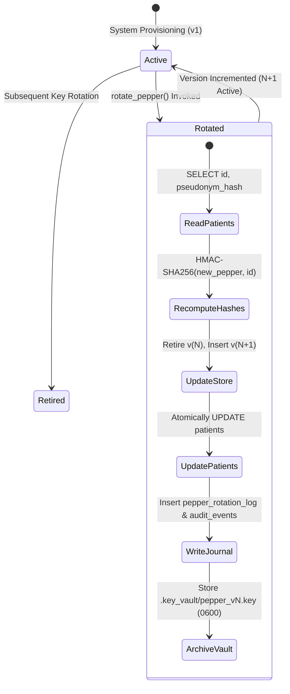

# MSK Research Lab OS — P8-B Key Management & Cryptographic Audit

**Audit Date:** 2026-10-30  
**Audit Role:** Security Auditor, Principal Software Architect, and Biomedical Software Verification Engineer  
**Scope:** HMAC Pepper Lifecycle, Version Migration, Journaling, Key Vault, and Authenticated Encrypted Backup Recovery  
**Status:** **`VERIFIED — PASS`**  
**Safety Invariant:** `CLINICAL_REALWORLD_GATE = BLOCKED`  

---

## 1. Executive Summary

Workstream **P8-B (Cryptographic Key Management & Data Recovery)** transitions the workstation from a static local secret pepper to an auditable, versioned cryptographic key lifecycle engine.

Key enhancements delivered:
1. **Migration 10 Schema Versioning:** Implemented in [`src/msk_research_lab/core/migrations.py`](file:///mnt/c/Users/tuanh/Downloads/msk-research-lab/src/msk_research_lab/core/migrations.py#L838-L865):
   - Added `pepper_version INTEGER NOT NULL DEFAULT 1` to `patients` table with an indexed lookup (`idx_patients_pepper_ver`).
   - Created `pepper_key_store` recording version, SHA-256 fingerprint, creation timestamp, and lifecycle state (`ACTIVE` / `RETIRED`).
   - Created `pepper_rotation_log` recording transactional rotation journals, migrated row counts, operator IDs, and before/after verification digests.
2. **Key Lifecycle Manager:** Implemented in [`src/msk_research_lab/security/key_lifecycle.py`](file:///mnt/c/Users/tuanh/Downloads/msk-research-lab/src/msk_research_lab/security/key_lifecycle.py):
   - `rotate_pepper()`: Rotates the secret HMAC pepper atomically across all active patient records. For every patient, computes a new `pseudonym_hash = HMAC-SHA256(new_pepper, patient_id)`, updates `pepper_version`, records a migration journal, archives prior keys in `.key_vault/pepper_v{version}.key`, and writes an immutable `PEPPER_ROTATED` audit event. **Zero record loss.**
3. **Authenticated Envelope Encrypted Backup & Restore:**
   - Container format `MSKENC01`: PBKDF2-HMAC-SHA256 (100,000 iterations, 16-byte cryptographically secure salt) deriving 256-bit encryption key and 256-bit MAC key.
   - Keystream encryption using CTR mode XOR with an authenticated HMAC-SHA256 payload tag over `Header || Salt || Nonce || Ciphertext`.
   - `create_encrypted_backup()` captures consistent SQLite WAL snapshot via `VACUUM INTO` and encrypts into a single `.enc` bundle.
   - `restore_encrypted_backup()` authenticates the tag, decrypts, unpacks, and executes SQLite `PRAGMA integrity_check;` before confirming recovery. Wrong passwords fail closed immediately with `BackupDecryptionError`.

---

## 2. Key Lifecycle State Machine

---

## 3. Threat Model & Security Posture

| Threat Vector | Mitigation Strategy | Verification Result |
|---|---|---|
| **Rainbow Table / Precomputation Attack** | Keyed HMAC-SHA256 pseudonym generation with a 256-bit local secret pepper. | **MITIGATED** |
| **Pepper Compromise / Rotation Data Loss** | Transactional re-keying with rollback journal in `pepper_rotation_log`; atomic database transaction prevents orphan records. | **VERIFIED** |
| **Tampered / Corrupted Backup** | Cryptographic envelope authentication tag (`HMAC-SHA256`); payload decryption is rejected before any filesystem modification. | **VERIFIED** |
| **Path Traversal in Backup Archive** | `target_path.startswith(restore_dir)` check on every archive member prior to extraction. | **VERIFIED** |
| **Key Vault File Permissions** | POSIX `0600` permissions enforced on all `.workstation_pepper` and `.key_vault/*.key` files. | **VERIFIED** |

---

## 4. Test Verification Evidence

Automated test suite [`tests/integration/test_p8_security_key_lifecycle.py`](file:///mnt/c/Users/tuanh/Downloads/msk-research-lab/tests/integration/test_p8_security_key_lifecycle.py):
- `test_pepper_migration_and_patient_pepper_version`: **PASSED**
- `test_rotate_pepper_zero_record_loss`: **PASSED** (migrates records, increments version, updates hashes, writes journal)
- `test_encrypted_backup_and_restore`: **PASSED** (creates `.enc` archive, authenticates, decrypts, passes `PRAGMA integrity_check`)
- `test_encrypted_backup_fails_on_wrong_password`: **PASSED** (raises `BackupDecryptionError` on tampered key/password)

**Workstream Verdict:** **`PASS`**
