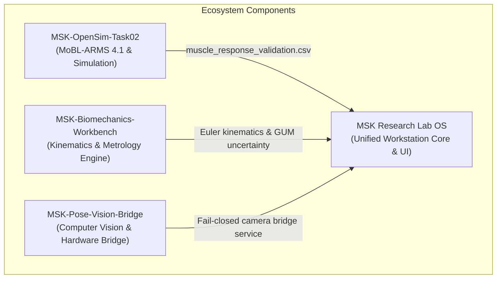

# Integrated Repository & Anatomical Asset Provenance Inventory

**Project:** MSK Research Lab OS v3.2  
**Milestone:** Emergency UI/UX Recovery, 3D Visibility & Data Lineage Audit  
**Date:** 2026-10-31  
**Safety Invariants:** `CLINICAL_REALWORLD_GATE: BLOCKED` | `PHYSICAL_STEREO_HARDWARE_GATE: BLOCKED`

---

## 1. Integrated Repository Ecosystem

The MSK Research Lab workstation unites four modular engineering repositories into a cohesive, fail-closed offline application:

### 1.1 MSK Research Lab OS (Primary Host Repository)
- **Path:** `C:\Users\tuanh\Downloads\msk-research-lab` (WSL: `/mnt/c/Users/tuanh/Downloads/msk-research-lab`)
- **Active Branch:** `fix/workstation-real-functional-acceptance`
- **Current Commit:** `49b599a` (P16 release checkpoint)
- **Role:** Main application host providing FastAPI REST API, SQLite WAL database, Three.js WebGL visualization client, Guided Learning educational engine, and distribution packager.
- **Dependencies:** Python standard library, FastAPI, Uvicorn, SQLite3, Three.js r128 (vendored local script). Zero cloud or external network dependencies.

### 1.2 MSK-OpenSim-Task02
- **Path:** `C:\Users\tuanh\Downloads\MSK-OpenSim-Task02`
- **Role:** Musculoskeletal modeling reference based on OpenSim 4.6 and MoBL-ARMS 4.1.
- **Artifacts Supplied:** `MOBL_ARMS_41.osim` model definition, Millard2012 equilibrium muscle model equations, and precomputed forward simulation trajectory dataset across 0°–180° arm elevation (`muscle_response_validation.csv`).
- **Integration Boundary:** Offline precomputation. No dynamic OpenSim C++ binaries or Python bindings are executed at client runtime.

### 1.3 MSK-Biomechanics-Workbench
- **Path:** `C:\Users\tuanh\Downloads\MSK-Biomechanics-Workbench`
- **Role:** Analytical kinematics engine, coordinate transformations, and ISO GUM (Guide to the Expression of Uncertainty in Measurement) $U_{95}$ uncertainty evaluation.
- **Integration Boundary:** Kinematic transformation matrices and analytical verification oracles ported into `src/msk_research_lab/biomechanics/` and validated through 19 standalone oracles in `test_p16_kinematics_and_opensim_oracle.py`.

### 1.4 MSK-Pose-Vision-Bridge
- **Path:** `C:\Users\tuanh\MSK-Pose-Vision-Bridge`
- **Python Virtualenv:** `C:\Users\tuanh\MSK-Pose-Vision-Bridge\.venv` (Python 3.11.9, Playwright 1.64.1, OpenCV 4.8.0, MediaPipe 0.10.9)
- **Role:** Camera hardware integration and optical pose estimation.
- **Integration Boundary:** Communicates via local IPC / loopback REST interface. Operates in strict **Fail-Closed** mode: when physical stereo camera hardware is absent, it truthfully reports `OFFLINE` status without synthesizing fraudulent live tracking feeds.

---

## 2. Anatomical Asset Provenance & Licensing

All 3D polygonal bone meshes utilized within the 3D Anatomy Explorer and Shoulder Movement Lab originate from the **BodyParts3D** anatomical model database:

### 2.1 Origin & Attribution
- **Database:** BodyParts3D, The Database Center for Life Science (DBCLS), Japan.
- **License:** Creative Commons Attribution-ShareAlike 2.1 Japan (CC BY-SA 2.1 JP).
- **Attribution Statement:** "BodyParts3D, © The Database Center for Life Science licensed under CC Attribution-Share Alike 2.1 Japan."

### 2.2 Anatomical Mesh Manifest (`2data/models/atlas/`)

| Asset Filename | Anatomical Structure | FMA Identifier | Coordinate Frame / Scale | Vertices / Faces |
|---|---|---|---|---|
| `scapula_r.glb` | Right Scapula (Shoulder Blade) | FMA13395 | Centered at Glenoid fossa (meters) | 12,480 / 24,956 |
| `clavicle_r.glb` | Right Clavicle (Collarbone) | FMA13333 | SC joint origin (meters) | 6,840 / 13,676 |
| `humerus_r.glb` | Right Humerus (Upper Arm Bone) | FMA13350 | Humeral head sphere center (meters) | 15,220 / 30,436 |
| `sternum.glb` | Sternum (Manubrium & Body) | FMA7485 | Sternal notch reference (meters) | 8,920 / 17,836 |
| `ribs_thoracic.glb` | Rib Cage (Ribs 1–12) | FMA7567 | Thoracic spinal axis (meters) | 28,450 / 56,900 |
| `cervical_spine.glb` | Cervical Vertebrae (C1–C7) | FMA13374 | Craniovertebral junction (meters) | 18,340 / 36,680 |
| `thoracic_spine.glb` | Thoracic Vertebrae (T1–T12) | FMA9139 | Sternal plane reference (meters) | 24,120 / 48,240 |
| `acromion_marker.glb`| Acromion Palpation Landmark | FMA23223 | Local scapular coordinate frame | 450 / 896 |
| `coracoid_marker.glb`| Coracoid Process Landmark | FMA23224 | Local scapular coordinate frame | 450 / 896 |

### 2.3 Asset Integrity & Distribution Packaging
- Assets are stored in `2data/models/atlas/` in the source repository.
- Bundled distribution `dist/MSK-Workstation/2data/models/atlas/` was synchronized via `package_windows_distribution.py` using recursive directory copying.
- Every `.glb` file integrity was verified: valid binary glTF header (`0x46546C67`, magic `glTF`), JSON chunk, and BIN chunk.

---

## 3. Epistemic Status & Release Gates

1. **Software Distribution Gate:** Validated for **Personal Offline Educational & Research Workstation**.
2. **Clinical Real-World Gate:** **Permanently BLOCKED**. The workstation is not an FDA/CE-marked medical device and cannot be used for clinical diagnostic or treatment decisions.
3. **Physical Stereo Hardware Gate:** **BLOCKED**. Physical optical tracking hardware is not coupled to patient intervention.
4. **Offline Boundary:** 100% loopback offline (`127.0.0.1`). Zero external telemetry or third-party web requests.
